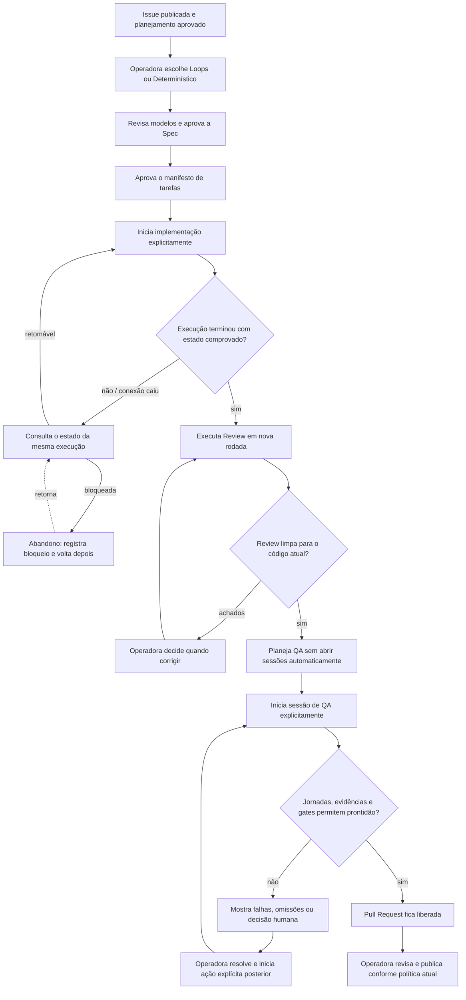

```yaml
journey:
  id: J-deterministic-issue-delivery
  name: Entregar uma Issue com etapas controladas
  value_statement: A pessoa conclui uma Issue acompanhando execuções delimitadas, resultados comprovados e bloqueios antes da Pull Request.
  personas: [Marina, Caio, Lia]
  entry_points:
    - url: workspace de Issues do projeto
      origin: in-app-nav
  actions:
    - step: 1
      verb: Escolhe o modo e confere as configurações de cada etapa.
      expected_observable: O modo salvo e os modelos efetivos continuam visíveis após recarregar.
    - step: 2
      verb: Aprova Spec e tarefas, uma etapa de cada vez.
      expected_observable: Cada aprovação confirma a versão revisada sem iniciar a etapa seguinte.
    - step: 3
      verb: Inicia implementação e acompanha o estado real da execução.
      expected_observable: A etapa mostra progresso, conclusão comprovada ou bloqueio recuperável.
    - step: 4
      verb: Executa Review e decide se corrige os achados.
      expected_observable: Rodadas e achados ficam no histórico; correções e nova Review exigem ação explícita.
    - step: 5
      verb: Planeja e executa sessões de QA.
      expected_observable: Jornadas, veredictos, evidências e pendências aparecem sem declarar prontidão por omissão.
    - step: 6
      verb: Abre Pull Request após os gates válidos.
      expected_observable: A etapa mostra a liberação ou a razão específica que ainda bloqueia.
  goal:
    observable: A Issue apresenta histórico de execução, Review e QA e só libera a Pull Request quando os requisitos do modo selecionado estão comprovados.
    side_effects: [resultados-de-run-preservados]
  true_end_state: A pessoa operadora consegue explicar quais etapas foram executadas, quais evidências sustentam prontidão e quais ações ainda dependem dela.
  exit:
    natural: Etapa Pull Request ou bloqueio visível com instrução de retomada.
  abandonment:
    - at_step: 3
      how: A conexão cai enquanto uma execução longa está em andamento.
      resume: A tela reconcilia a mesma execução antes de permitir outra tentativa.
    - at_step: 5
      how: A pessoa encerra a sessão de QA antes de percorrer todas as jornadas.
      resume: O relatório continua identificável e mostra sessões pendentes ou bloqueadas.
  crosses: [interface-web, API, conector-local, CLI Compozy antigo, arquivos de QA]
```

Considerações de cobertura: funcional e jornada estão nos cenários abaixo; acessibilidade e responsividade serão percorridas nas sessões; concorrência/retomada será exercitada pelo charter de recuperação. Tours de dinheiro, upload e locale foram omitidos por não corresponderem ao fluxo.
