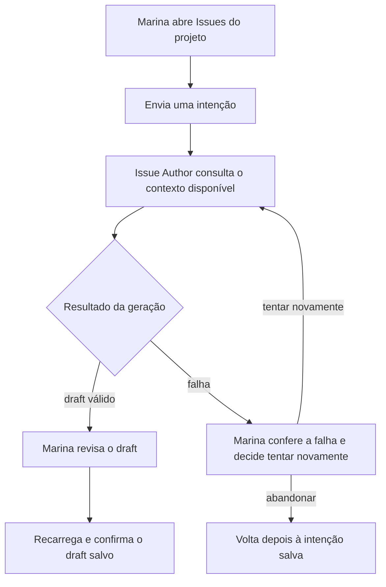

# Gerar e revisar o draft de uma Issue

Persona: Marina. Entrada: workspace de Issues do projeto. Objetivo: obter um draft salvo que possa revisar antes de publicar. O limite das consultas de contexto pode interromper novas buscas sem invalidar um draft válido baseado nas evidências já disponíveis. Uma falha deve manter a intenção acessível para uma tentativa posterior.
