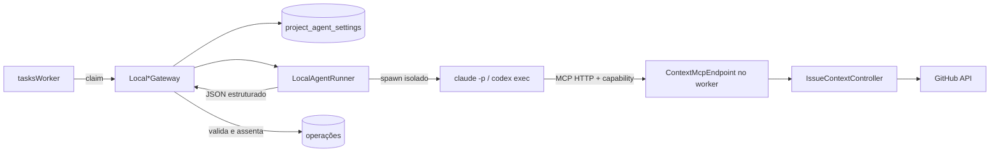

# Spec: Issue Author e Planejamento com a assinatura da máquina

> **Status:** Implementada (revisão de conformidade: review-003, APROVADO COM RESSALVAS) · **Data:** 2026-11-21 · **Nível:** L3 spec-first
> **Contexto lido:** `packages/api/src/infra/issue-author/devControlIssueAuthorGateway.ts`, `packages/api/src/infra/planning/devControlPlanningGateway.ts`, `packages/api/src/controllers/issueContextController.ts`, `packages/api/src/controllers/taskWorkerController.ts`, `packages/api/src/infra/composition.ts`, `apps/web/src/features/projects/project-settings/`, `apps/web/PRODUCT.md`; no repositório irmão `../Dev_Control`: `src/mastra/agents/{issue-author-v1,planning-agent}.ts`, `src/mastra/server/{issue-author-v1-route,planning-route}.ts`, `src/mastra/skills/{create-github-issue,determine-spec-path}/`, `src/mastra/providers/opencode-go.ts`.

## Resumo para revisão

- **O que muda:** o rascunho da Issue (Issue Author) e a recomendação de rota (Planejamento) passam a rodar dentro do Flow Dev, com o Claude Code ou o Codex logados na máquina, sem chave de API. Cada projeto escolhe provedor, modelo e esforço de cada agente numa nova seção das Configurações. O Flow Dev deixa de chamar o Dev_Control.
- **Por quê:** o Dev_Control (Mastra) só fala com modelos por API (`opencode-go glm-5.3` com `OPENCODE_API_KEY`), e o usuário quer usar as assinaturas Claude e ChatGPT que já tem na máquina.
- **Decisões principais:** DEC-01 rodar as CLIs em modo headless como processos filhos do worker; DEC-02 portar as skills para o monorepo; DEC-03 servir as ferramentas de contexto por um endpoint MCP local que reusa o broker atual; DEC-04 isolamento rígido do processo do agente; DEC-05 tabela de configuração por projeto em que a ausência de linha significa o padrão.
- **Riscos principais:** o agente local herdar acesso à máquina (shell, arquivos, instruções pessoais do usuário), mitigado por DEC-04 e provado no spike V-00 antes de qualquer outra tarefa; o limite de uso da assinatura, que vira erro claro e não troca de provedor.
- **Como vamos verificar:** testes unitários dos runners com CLIs falsas, integração do endpoint MCP com o broker real e o Postgres de teste, e2e da seção de configuração, e um smoke manual com as CLIs reais (V-00 e V-11).
- **Pendências:** nenhuma. Q-01 e Q-02 foram respondidas; o resultado do V-00 decide se o Codex entra (REQ-023).

---

# Parte 1 — Produto

## 1. Contexto e problema

A etapa inicial de uma tarefa tem dois agentes: o **Issue Author**, que conversa, consulta o repositório e entrega um rascunho de Issue ou uma pergunta, e o **Planejamento**, que recomenda Execução direta, Tech Spec ou PRD para a Issue publicada. Os dois rodam num serviço separado (Dev_Control), que só aceita modelos cobrados por chave de API. As assinaturas logadas na máquina (Claude Code e Codex) ficam sem uso, e cada geração consome créditos.

## 2. Usuários e papéis

- **Pessoa autora e pessoa operadora:** geram rascunhos e planejamentos como hoje; só notam a troca pelas mensagens de falha do provedor.
- **Administrador:** escolhe provedor, modelo e esforço de cada agente por projeto. É o mesmo papel que já edita as Configurações.
- **Membro sem papel de admin:** vê a configuração sem editar.
- **Pessoa que opera o ambiente:** sobe o Flow Dev sem o Dev_Control.

## 3. Objetivos

- **G1:** gerar rascunhos e planejamentos usando o login local do Claude Code ou do Codex, sem chave de API.
- **G2:** cada projeto escolhe, para cada agente, provedor, modelo e esforço de raciocínio.
- **G3:** o Flow Dev funciona sem o Dev_Control.
- **G4:** os agentes mantêm as garantias de hoje: mesmas instruções, só o repositório vinculado como contexto, fontes rastreáveis, nenhuma escrita no GitHub e nenhuma ação na máquina.

## 4. Fora de escopo

- **OpenCode como provedor:** não foi pedido nesta rodada, e a saída estruturada dele é menos rígida.
- **Troca automática de provedor quando um falha:** decidido que a falha aparece para a pessoa (REQ-010).
- **Configuração global ou por usuário:** decidido que vale por projeto.
- **Rodar o worker num servidor sem as CLIs:** o Flow Dev continua rodando na máquina que tem as assinaturas (premissa P-01).
- **Etapa de execução (Spec, Implementação, Review, QA, PR), Compozy e conector local:** foram removidos em `7b0b205`/`c78d44d` e serão reescritos à parte.
- **Mudar ou arquivar o repositório Dev_Control:** fica intocado.
- **Mandar as imagens das mensagens ao agente:** hoje elas também não vão.
- **Descobrir modelos consultando a CLI:** a lista é fixa (Q-01).

## 5. Histórias de usuário

### US-01 — Gerar rascunho com a assinatura (P1)
Como pessoa autora, quero que o Issue Author rode com o Claude Code ou o Codex da máquina, para gerar Issues sem gastar créditos de API.
- **Por que P1:** é o motivo da mudança e o primeiro passo de toda tarefa.
- **Teste independente:** com o Dev_Control desligado e sem `OPENCODE_API_KEY`, enviar uma mensagem e receber um rascunho.
- **Cenários de aceite:**
  1. **Dado** o projeto `acme/shop` sem configuração salva e o Claude Code logado, **quando** a autora envia "Trocar 'Entar' por 'Entrar' no botão de login", **então** a tarefa chega a "rascunho pronto", e a atividade mostra as consultas `searchProject` feitas.
  2. **Dado** uma mensagem ambígua ("melhorar o checkout"), **quando** o agente precisa de informação, **então** a tarefa fica "aguardando clarificação" com uma única pergunta, como hoje.
  3. **Dado** que a assinatura do Claude atingiu o limite, **quando** a geração roda, **então** ela falha com "A assinatura do Claude Code atingiu o limite de uso. Tente de novo mais tarde ou troque o provedor nas Configurações do projeto.", e nenhum rascunho é salvo.
  4. **Dado** o projeto configurado com Codex e o `codex` deslogado, **quando** a geração roda, **então** ela falha com uma mensagem que nomeia o Codex e pede `codex login`.

### US-02 — Planejar com a assinatura (P1)
Como pessoa operadora, quero que o Planejamento rode com a assinatura da máquina, para ter a recomendação de rota sem o Dev_Control.
- **Por que P1:** sem ele, a tarefa para depois da publicação.
- **Teste independente:** publicar uma Issue com o Dev_Control desligado e receber a recomendação pendente de revisão.
- **Cenários de aceite:**
  1. **Dado** a Issue #42 publicada, **quando** o planejamento roda com Claude Code + Sonnet + esforço baixo, **então** a recomendação aparece com rota, complexidade e motivos que citam `issue` ou evidências desta execução.
  2. **Dado** que o agente cita uma evidência que não consultou, **quando** a resposta chega, **então** a tentativa falha como saída inválida e segue a regra de novas tentativas de hoje.
  3. **Dado** que a CLI não responde em 240 s, **quando** o prazo vence, **então** o processo é encerrado e a tentativa falha por tempo, como hoje.

### US-03 — Escolher provedor, modelo e esforço por projeto (P2)
Como administrador, quero escolher o provedor, o modelo e o esforço de cada agente do projeto, para equilibrar qualidade, prazo e limite de cada assinatura.
- **Por que P2:** o padrão (REQ-017) já entrega US-01 e US-02; a escolha vem depois.
- **Teste independente:** salvar Codex no Planejamento de um projeto e ver o próximo planejamento rodar com Codex.
- **Cenários de aceite:**
  1. **Dado** um admin nas Configurações de `acme/shop`, **quando** escolhe Planejamento → Codex, `gpt-6.1-sol`, Médio e salva, **então** a seção mostra a nova escolha, e o Issue Author continua com o padrão.
  2. **Dado** um membro sem papel de admin, **quando** abre as Configurações, **então** vê as escolhas dos dois agentes sem controles de edição.
  3. **Dado** dois admins com a página aberta, **quando** o segundo salva depois do primeiro, **então** recebe "A configuração mudou desde que você abriu a página. Recarregue para ver a versão atual.", e nada é sobrescrito.
  4. **Dado** um planejamento em andamento com Claude, **quando** o admin troca para Codex, **então** essa tentativa termina com Claude, e a próxima usa Codex.

### US-04 — Rodar sem o Dev_Control (P2)
Como pessoa que opera o ambiente, quero subir o Flow Dev sem o Dev_Control e sem as variáveis dele, para ter um único serviço.
- **Teste independente:** remover as variáveis do Dev_Control do `.env.local`, subir `pnpm dev` e completar US-01 e US-02.
- **Cenários de aceite:**
  1. **Dado** um `.env.local` sem `ISSUE_AUTHOR_BASE_URL`, `ISSUE_AUTHOR_API_KEY`, `PLANNING_BASE_URL`, `PLANNING_API_KEY` e `FLOW_DEV_INTERNAL_API_KEY`, **quando** a operadora pede um planejamento, **então** ele começa (o erro "planejamento não configurado" não aparece mais).
  2. **Dado** o Flow Dev em execução, **quando** alguém chama a rota interna antiga de contexto, **então** recebe 404.

## 6. Requisitos funcionais

**Execução dos agentes**
- **REQ-001** (US-01): QUANDO uma geração de rascunho for processada, o sistema DEVE executá-la com o provedor, o modelo e o esforço configurados para o Issue Author do projeto da tarefa, usando o login local da CLI.
- **REQ-002** (US-02): QUANDO uma tentativa de planejamento for processada, o sistema DEVE executá-la com o provedor, o modelo e o esforço configurados para o Planejamento do projeto.
- **REQ-003** (US-03): O sistema DEVE fixar a configuração de cada tentativa no momento em que ela começa; uma nova tentativa (retry ou novo envio) DEVE ler a configuração vigente.
- **REQ-004** (US-01, US-02): O sistema DEVE dar a cada agente as mesmas instruções e as mesmas entradas de hoje: para o Issue Author, a conversa, o rascunho atual e a revisão base; para o Planejamento, o snapshot da Issue publicada.
- **REQ-005** (US-01, US-02): O sistema DEVE oferecer ao agente apenas as quatro consultas de contexto de hoje (buscar no projeto, ler trecho de arquivo, buscar Issues, ler uma Issue), restritas ao repositório e ao commit fixados da execução e registradas na atividade. O Planejamento já tinha essas consultas no Dev_Control; a mudança de texto na interface só corrige o que ela dizia.
- **REQ-006** (US-01, US-02): O sistema DEVE executar o agente sem nenhuma outra capacidade: sem shell, sem leitura ou escrita de arquivos da máquina, sem web e sem outros servidores de ferramentas.
- **REQ-007** (US-01, US-02): SE um provedor não puder ser iniciado com a restrição de REQ-006, ENTÃO o sistema DEVE recusar a execução sem chamar o modelo.
- **REQ-008** (US-01, US-02): QUANDO o agente terminar, o sistema DEVE validar a resposta pelos mesmos contratos de hoje (formato do rascunho, formato da avaliação, motivos citando só `issue` ou evidências desta execução, Execução direta sem pendência bloqueante) e tratar a resposta fora do contrato como saída inválida.
- **REQ-009** (US-01, US-02): SE a CLI do provedor configurado não estiver instalada ou não estiver logada, ENTÃO o sistema DEVE falhar a tentativa com uma mensagem que nomeia a CLI e o comando de login.
- **REQ-010** (US-01, US-02): SE a assinatura atingir o limite de uso, ENTÃO o sistema DEVE falhar a tentativa com uma mensagem que nomeia o provedor e sugere trocar o provedor nas Configurações, sem tentar outro provedor.
- **REQ-011** (US-02): SE o prazo da tentativa vencer (600 s no Issue Author, 240 s por tentativa e 900 s no total no Planejamento), ENTÃO o sistema DEVE encerrar o processo do agente e todos os filhos dele, e descartar qualquer saída parcial.
- **REQ-012** (US-02): QUANDO uma tentativa for cancelada ou ficar obsoleta, o sistema DEVE encerrar o processo do agente em até 5 s. Na geração do rascunho, o port `IssueAuthorGateway` não recebe sinal de cancelamento (e não muda), então a geração só para pelo prazo de 600 s ou pelo encerramento do worker (NFR-03); o cancelamento por tentativa obsoleta vale para o Planejamento.
- **REQ-013** (US-01, US-02): O sistema DEVE executar cada tentativa sem carregar instruções, memórias, hooks, plugins ou servidores de ferramentas pessoais do usuário, e sem guardar o histórico da sessão da CLI.

**Configuração por projeto**
- **REQ-014** (US-03): As Configurações do projeto DEVEM mostrar uma seção "Agentes" com dois blocos, Issue Author e Planejamento, cada um com provedor, modelo e esforço.
- **REQ-015** (US-03): QUANDO um admin salvar a seção, o sistema DEVE gravar a escolha do agente editado e exibi-la; SE quem salvar não for admin, ENTÃO o sistema DEVE recusar a gravação no servidor.
- **REQ-016** (US-03): SE o modelo não pertencer à lista do provedor ou o esforço não for Baixo, Médio ou Alto, ENTÃO o sistema DEVE recusar com "Escolha um modelo e um esforço disponíveis para este provedor."
- **REQ-017** (US-01, US-02): ENQUANTO um agente não tiver configuração salva no projeto, o sistema DEVE usar Claude Code + Sonnet + esforço Baixo.
- **REQ-018** (US-03): SE a configuração tiver mudado desde que a página foi aberta, ENTÃO o sistema DEVE recusar a gravação com a mensagem de US-03 cenário 3.
- **REQ-019** (US-03): SE uma configuração salva apontar para um modelo que saiu da lista, ENTÃO a seção DEVE mostrar "Modelo indisponível, escolha outro", e as tentativas DEVEM falhar com mensagem que pede a troca, sem usar outro modelo.

**Retirada do Dev_Control**
- **REQ-020** (US-04): O sistema NÃO DEVE chamar o Dev_Control nem exigir as variáveis de ambiente dele.
- **REQ-021** (US-04): O sistema DEVE remover a rota interna de contexto, cujo único consumidor era o Dev_Control.
- **REQ-022** (US-04): QUANDO a operadora pedir um planejamento, o sistema NÃO DEVE mais exigir a configuração do serviço externo para começar.
- **REQ-023** (US-03): SE o V-00 mostrar que o Codex não roda sem shell, ENTÃO o catálogo DEVE oferecer só o Claude Code, e a entrega segue sem o Codex (Q-02).

## 7. Regras de negócio

- **Provedores:** Claude Code e Codex; o Codex depende do V-00 (REQ-023).
- **Modelos por provedor** (lista fixa, confirmada em Q-01): Claude Code: `sonnet`, `opus`, `haiku`. Codex: `gpt-6.1-sol`.
- **Esforço:** Baixo, Médio ou Alto, que viram `low`, `medium` e `high` nas duas CLIs.
- **Padrão:** REQ-017, igual para os dois agentes.
- **Unicidade:** um projeto tem no máximo uma configuração por agente.
- **Permissões:**

| Ação | Admin | Membro do projeto | Fora do projeto |
|---|---|---|---|
| Ver a configuração dos agentes | sim | sim | não (mesma regra das Configurações hoje) |
| Salvar a configuração | sim | não | não |

## 8. Casos de borda e erros

| ID | Situação | Comportamento esperado | Ref. |
|---|---|---|---|
| B-01 | Duas gerações simultâneas (2 vagas no worker) na mesma assinatura | As duas rodam; se o limite estourar, cada uma falha por REQ-010 | REQ-010 |
| B-02 | A CLI sai com código 0 mas sem resposta estruturada, ou com JSON fora do contrato | Saída inválida (REQ-008) | REQ-008 |
| B-03 | A CLI entrega a resposta e não encerra | A resposta é aproveitada e o processo é encerrado | REQ-012 |
| B-04 | O texto da Issue ou da conversa pede ao agente para rodar comandos ou ler arquivos | Não há ferramenta para isso (REQ-006); a resposta passa por REQ-008 | REQ-006 |
| B-05 | O worker é reiniciado no meio de uma tentativa | O lease vence e a tentativa é retomada como hoje; o processo antigo não sobrevive a um encerramento normal do worker (NFR-03) | REQ-012 |
| B-06 | Operações enfileiradas antes da mudança | São processadas pelo novo motor; a entrada é a mesma | REQ-004 |
| B-07 | O agente pede mais de 12 consultas | A consulta excedente volta "indisponível" (limite de hoje), e o agente responde com o que tem | REQ-005 |
| B-08 | A consulta chega com uma credencial de outra execução ou vencida | É recusada pelas regras atuais do broker | REQ-005 |
| B-09 | O admin perde o papel com a página aberta | A gravação é recusada (REQ-015) | REQ-015 |

## 9. Comportamento que não muda

- QUANDO a pessoa autora enviar, editar, pedir clarificação ou publicar, o sistema DEVE CONTINUAR A seguir os mesmos estados e transições da tarefa.
- O sistema DEVE CONTINUAR A aplicar os limites do broker: 12 consultas por execução, até 300 linhas por leitura, 64 KB por resultado, commit fixado na primeira consulta.
- O sistema DEVE CONTINUAR A exigir que as fontes do rascunho venham de evidências desta execução (erro `invalid_agent_source`) e a aplicar o limite de 40.000 caracteres do contexto do rascunho.
- O sistema DEVE CONTINUAR A tentar o planejamento até 3 vezes dentro de 900 s, e a deixar a aprovação final com a pessoa, sem escrever no GitHub.
- O sistema DEVE CONTINUAR A mostrar na interface a atividade de consulta de cada execução.
- O sistema DEVE CONTINUAR A exibir as mensagens atuais de falha (`generation_timeout`, `invalid_agent_output`, `planning_timeout` etc.); só muda a mensagem de limite de uso (REQ-010).
- Nome, descrição, repositório e quadro nas Configurações do projeto DEVEM CONTINUAR iguais.

## 10. Requisitos não funcionais

- **NFR-01** (segurança): o processo do agente DEVE receber um ambiente com lista de permissão: `PATH`, `HOME`, idioma, as variáveis de que a CLI precisa para achar o próprio login, e a credencial da execução. Nunca `DATABASE_URL`, `GITHUB_REPOSITORY_TOKEN_KEY`, `BETTER_AUTH_SECRET`, tokens do GitHub ou qualquer outra variável do `.env.local`.
- **NFR-02** (desempenho): com a configuração padrão, o planejamento de uma Issue real de até 5 KB DEVE terminar em até 240 s em 3 de 3 execuções do smoke V-11, e a geração de um rascunho em até 600 s.
- **NFR-03** (confiabilidade): depois de prazo vencido, cancelamento ou SIGTERM no worker, não DEVE sobrar nenhum processo da CLI em até 5 s.
- **NFR-04** (observabilidade): ver a seção 19.

## 11. Premissas e dependências

- **P-01:** o worker (`tasksWorker`) roda na mesma máquina e com o mesmo usuário do sistema que fez `claude` login e `codex login`.
- **P-02:** as versões instaladas hoje (Claude Code 2.1.329, Codex CLI 0.159.3) são a base. Uma atualização de CLI que mude flags exige rodar V-00 de novo.
- **P-03:** usar a assinatura pessoal por automação local segue os termos de cada provedor para uso individual. A decisão é do usuário; a spec não a avalia.
- **P-04:** as permissões da nova seção seguem as das Configurações de hoje (só admin edita).

---

# Parte 2 — Técnica

## 12. Visão geral da solução

Os ports `IssueAuthorGateway` e `PlanningGateway` continuam iguais; só as implementações mudam. Os gateways locais montam o prompt com as skills portadas (DEC-02) e chamam um `LocalAgentRunner` (Claude Code ou Codex), que inicia a CLI isolada (DEC-04) com o JSON Schema da resposta. A CLI consulta o repositório por um endpoint MCP servido pelo próprio worker (DEC-03), que reusa o `IssueContextController` com as regras de hoje. A atividade e a validação de citações, que vinham do Dev_Control, saem das chamadas registradas para a execução.



## 13. Componentes e responsabilidades

| Componente | Responsabilidade | Local | Novo/Alterado |
|---|---|---|---|
| Port do runner | Contrato `run()` e erros tipados | `packages/api/src/application/agents/localAgentRunner.ts` | Novo |
| Catálogo de agentes | Provedores, modelos, esforços, padrão (seção 7) | `packages/api/src/application/agents/agentCatalog.ts` | Novo |
| Runner Claude Code | Argumentos, ambiente e leitura do resultado do `claude -p` | `packages/api/src/infra/agents/claudeCodeRunner.ts` | Novo |
| Runner Codex | O mesmo para `codex exec` | `packages/api/src/infra/agents/codexRunner.ts` | Novo |
| Supervisor de processo | spawn em grupo próprio, prazo, kill da árvore, limite de saída (256 KB) | `packages/api/src/infra/agents/agentProcess.ts` | Novo |
| Classificador de falhas | stderr/eventos → `usage_limit`, `not_signed_in`, `missing_binary`, `invalid_output` | `packages/api/src/infra/agents/agentFailure.ts` | Novo |
| Endpoint MCP de contexto | Servidor MCP HTTP em loopback; capability → execução; delega ao controller | `packages/api/src/infra/agents/contextMcpEndpoint.ts` | Novo |
| Prompts portados | Skills `create-github-issue` (+ references) e `determine-spec-path` | `packages/api/resources/agents/{issue-author,planning}/` | Novo |
| Gateways locais | Prompt, schema, configuração, validação, atividade | `packages/api/src/infra/issue-author/localIssueAuthorGateway.ts`, `packages/api/src/infra/planning/localPlanningGateway.ts` | Novo |
| Serviço de configuração | Ler com padrão; salvar com permissão, validação e versão | `packages/api/src/application/services/projects/agentSettingsService.ts` + DAO | Novo |
| Procedures | `projects.agentSettings.get` / `.update` | `packages/api/src/routers/projects.ts` | Alterado |
| Composição | Trocar os gateways DevControl; subir o endpoint MCP com o worker | `packages/api/src/infra/composition.ts`, `planningComposition.ts`, `src/cli/tasksWorker.ts` | Alterado |
| UI | Seção "Agentes" (editor e somente leitura) | `apps/web/src/features/projects/project-settings/components/AgentSettings*.tsx` + hook | Novo |
| Mensagens | Novos códigos e o texto de limite de uso | `apps/web/src/features/issues/issue-composer/taskCopy.ts` e a copy do planejamento | Alterado |
| Remoções | `devControl*`, `planningInputGuard.ts`, `planningConfiguration.ts`, `apps/web/src/app/api/internal/issue-context/route.ts`, variáveis do `.env.example` | — | Removido |

## 14. Modelo de dados

Nova tabela `project_agent_settings`:

| Coluna | Tipo | Regra |
|---|---|---|
| `project_id` | uuid FK → projects, `on delete cascade` | PK composta |
| `agent` | text | `check in ('issue_author','planning')`, PK composta |
| `provider` | text | `check in ('claude','codex')` |
| `model` | text | 1–64 caracteres; pertencer ao catálogo é validado na aplicação (REQ-016), não no banco, para que REQ-019 continue possível |
| `effort` | text | `check in ('low','medium','high')` |
| `version` | integer | começa em 1; sobe a cada gravação (REQ-018) |
| `updated_by` | FK → users | |
| `updated_at` | timestamptz | |

- **Dados existentes:** nenhum backfill. A ausência de linha significa o padrão (REQ-017).
- **Concorrência:** a primeira gravação de um agente usa `insert ... on conflict do nothing`. O `expectedVersion` 0 representa "sem linha".
- **Migration:** a próxima do journal (índice 45), com um `_rollback.sql` como as demais. O banco de desenvolvimento ainda guarda a 0045 revertida (`c78d44d`). O migrator compara timestamps, então a nova roda, mas use um nome distinto (`0045_project_agent_settings`) e registre-a no journal.

## 15. Interfaces e contratos

```ts
// application/agents/localAgentRunner.ts
type AgentProvider = "claude" | "codex";
type AgentEffort = "low" | "medium" | "high";
type AgentChoice = { provider: AgentProvider; model: string; effort: AgentEffort };
type AgentRun = {
  choice: AgentChoice;
  instructions: string;         // skill portada + regras de fronteira
  prompt: string;               // entrada da operação (REQ-004)
  outputSchema: object;         // JSON Schema da resposta
  context: { url: string; capability: string }; // endpoint MCP desta execução
  timeoutMs: number;
  signal: AbortSignal;
};
type AgentRunFailure = "missing_binary" | "not_signed_in" | "usage_limit" | "provider_failed" | "invalid_output" | "timeout" | "cancelled" | "isolation_unavailable" | "model_unavailable";
interface LocalAgentRunner { run(input: AgentRun): Promise<{ output: unknown; durationMs: number }>; } // lança AgentRunError(failure)
```

```ts
// procedures tRPC (packages/api/src/routers/projects.ts)
agentSettings.get:    input { projectId }                         → { agents: Array<AgentChoice & { agent: "issue_author" | "planning"; version: number; isDefault: boolean; modelAvailable: boolean }>, catalog }
agentSettings.update: input { projectId, agent, provider, model, effort, expectedVersion } → mesmo item atualizado
// erros: FORBIDDEN (não admin), BAD_REQUEST reason "agent_settings_invalid" (REQ-016), CONFLICT reason "agent_settings_conflict" (REQ-018)
```

**Mapeamento de falhas para os códigos da tarefa** (os códigos novos ganham mensagem na UI):

| `AgentRunFailure` | Geração | Planejamento |
|---|---|---|
| `missing_binary`, `not_signed_in`, `isolation_unavailable` | `local_agent_unavailable` (novo) | `planning_local_agent_unavailable` (novo) |
| `usage_limit` | `provider_usage_limit` (texto novo, REQ-010) | `planning_rate_limited` (texto novo) |
| `model_unavailable` | `agent_settings_invalid` (novo) | `planning_agent_settings_invalid` (novo) |
| `provider_failed` (saída ≠ 0 sem padrão conhecido) | `provider_unavailable` | `planning_provider_unavailable` |
| `invalid_output` | `invalid_agent_output` | `planning_invalid_output` |
| `timeout` | `generation_timeout` | `planning_timeout` |
| `cancelled` | — | `stale_execution` |

O detalhe da falha (qual CLI, qual comando de login) é gravado junto do código (`provider_usage_limit|Claude Code`) e devolvido pelos DTOs como `detail`; a UI o usa na frase. Ele nunca carrega a saída bruta da CLI.

**Endpoint MCP:** `POST http://127.0.0.1:<porta efêmera>/mcp` (streamable HTTP), com `Authorization: Bearer <capability>`. Ferramentas `searchProject`, `readProjectFile`, `searchGitHubIssues` e `getGitHubIssue`, com os mesmos schemas de entrada de `../Dev_Control/src/mastra/tools/flow-dev-context-tools.ts`. O `toolCallId` é gerado pelo endpoint. O resultado é o `ScopedContextResult` que o controller já devolve.

## 16. Fluxos principais

**Geração (Issue Author)**
1. O worker reivindica a operação e monta `GenerationInput` como hoje.
2. O `LocalIssueAuthorGateway` lê a configuração do projeto (REQ-003: lida uma vez aqui) e registra a capability da execução no endpoint MCP.
3. O gateway monta `instructions` (SKILL + references + regras de fronteira de `issue-author-v1.ts`) e `prompt` (conversa, rascunho atual, revisão base, como o `generationContext` do Dev_Control).
4. O runner inicia a CLI (DEC-04) com o schema de `issueAuthorResultSchema`, portado de `../Dev_Control/src/mastra/schemas/issue-author-result.ts`.
5. A CLI consulta o endpoint MCP → `IssueContextController.handle` (capability, limites e registro como hoje).
6. O gateway valida `needs_clarification | draft_ready` com `issueDraftSchema`, monta `activity` a partir das chamadas registradas da execução e devolve o `GenerationEnvelope`. A liquidação segue igual.

**Planejamento:** o mesmo caminho, com o prazo por tentativa de `PLANNING_REQUEST_DEADLINE_MS` e o `signal` do worker (REQ-012). Antes de devolver o `PlanningEnvelope`, o gateway aplica `citesOnlyRetrievedSources` e a regra "DIRECT sem pendência bloqueante", portadas de `../Dev_Control/src/mastra/server/planning-route.ts`.

**Configuração:** a UI chama `agentSettings.update`. O serviço verifica que quem chama é admin, valida contra o catálogo e grava com `version = expectedVersion + 1` condicionado à versão atual.

## 17. Decisões técnicas

### DEC-01 — CLIs em modo headless como processos filhos do worker
- **Decisão:** rodar `claude -p --output-format json --json-schema …` e `codex exec --output-schema … --json` via `child_process.spawn`.
- **Alternativas consideradas:**
  - **SDKs (Claude Agent SDK, Codex SDK):** duas dependências pesadas, com binários próprios e versões descasadas das CLIs logadas. Não trazem nada que o modo headless não dê.
  - **Compozy/ACP:** acabou de ser revertido, exige daemon e tem as falhas registradas no conector local.
  - **Manter o Mastra com um provider que embrulha a CLI:** mantém dois serviços e o salto HTTP, o contrário de unificar.
- **Consequências:**
  - Cada tentativa paga a partida da CLI (alguns segundos).
  - O comportamento depende das flags de cada versão de CLI (P-02, V-00).
  - Não há dependência nova para rodar o modelo.

### DEC-02 — Skills portadas para o monorepo
- **Decisão:** copiar `create-github-issue` (com `references/`), `determine-spec-path`, os schemas de resposta e as regras de fronteira para `packages/api/resources/agents/`. O monorepo passa a ser a fonte da verdade.
- **Alternativas consideradas:**
  - **Ler do caminho `../Dev_Control`:** acopla ao repositório que está saindo.
  - **Strings em TS:** fere o limite de 100 linhas e dificulta a revisão do texto.
- **Consequências:** mudanças posteriores nas skills do Dev_Control não chegam mais ao Flow Dev. As evals do Dev_Control (`eval:issue-author`, `eval:planning`) não são portadas (sugestão fora do escopo).

### DEC-03 — Ferramentas de contexto por endpoint MCP em loopback dentro do worker
- **Decisão:** o worker sobe um servidor MCP HTTP em `127.0.0.1` com porta efêmera, usando `@modelcontextprotocol/sdk`, que é dependência nova. Ele autentica pela capability da execução e chama o `IssueContextController` em memória.
- **Alternativas consideradas:**
  - **Servidor MCP stdio lançado pela CLI:** precisaria passar `DATABASE_URL` e a chave dos tokens ao ambiente da CLI, o que fere NFR-01.
  - **Manter a rota interna do Next e uma ponte stdio:** mantém a chave de serviço e a dependência do app web no ar.
  - **Deixar a CLI ler um clone local:** perde a atividade, as evidências e os limites, e exige um clone por projeto.
- **Consequências:**
  - Só a capability (já com prazo e escopo) chega ao processo do agente.
  - A rota interna e `FLOW_DEV_INTERNAL_API_KEY` saem (REQ-021).
  - Uma dependência nova em `packages/api`.

### DEC-04 — Isolamento do processo do agente
- **Decisão:**
  - **Diretório:** cada tentativa roda num diretório temporário vazio, apagado no fim, com o ambiente de NFR-01 e o processo em grupo próprio (kill da árvore).
  - **Claude Code:** `--tools ""`, `--strict-mcp-config --mcp-config <json só com o endpoint>`, `--allowedTools` apenas `mcp__flow__*`, `--setting-sources ""`, `--no-session-persistence`, `--system-prompt <instructions>`.
  - **Codex (provado no V-00, ver `v00-spike.md`):** `CODEX_HOME` temporário só com um link para o `auth.json`, `--ephemeral --skip-git-repo-check --ignore-user-config --ignore-rules -C <tmp> -s read-only`, o MCP via `-c mcp_servers.flow.url=… -c mcp_servers.flow.bearer_token_env_var=… -c mcp_servers.flow.default_tools_approval_mode=approve`, `-c web_search="disabled"` e `--disable` de `shell_tool`, `unified_exec` e das demais ferramentas e recursos pessoais. O modo de código (`code_mode_host`) fica ligado, porque é por ele que as ferramentas MCP chegam ao modelo; ele só roda JavaScript sem `fs`, sem `child_process` e sem shell. O prompt vai pelo stdin nas duas CLIs.
- **Alternativas consideradas:**
  - **`claude --bare`:** isola melhor, mas não lê o login OAuth (só `ANTHROPIC_API_KEY`), o que derrota o objetivo.
  - **`HOME` temporário:** esconde as credenciais da assinatura.
  - **Diretório de configuração isolado com link para a credencial:** fica como plano B do V-00 se `--setting-sources ""` ainda carregar o `~/.claude/CLAUDE.md`.
- **Consequências:** o V-00 é bloqueante. Se o Codex não puder ficar sem shell, ele sai do catálogo (REQ-023), e o runner Codex não é implementado nesta entrega.

### DEC-05 — Configuração por projeto em tabela própria, sem linha = padrão
- **Decisão:** `project_agent_settings` (seção 14), com a versão por linha.
- **Alternativas consideradas:**
  - **Coluna JSON em `projects`:** mistura com a versão dos detalhes do projeto e gera conflito falso entre seções.
  - **Reusar `software_settings`:** é singleton global e orientado ao Compozy removido.
- **Consequências:** um padrão mudado no código vale na hora para todo projeto sem linha.

## 18. Segurança, privacidade e permissões

- **Autorização da gravação:** fica no `AgentSettingsService` (`isAdmin`), não só na UI. A leitura segue a visibilidade do projeto, como `findVisible`.
- **Superfície nova:** o processo do agente na máquina do usuário.
  - **Mitigações:** DEC-04, NFR-01, REQ-006/007/013.
  - **Abuso principal:** um texto de Issue que tenta fazer o agente ler `~/.ssh`. Sem ferramentas nativas não há como; o V-00 prova isso com um prompt adversarial.
- **Endpoint MCP:** escuta só em loopback. Recusa sem capability válida, recusa uma capability de execução encerrada (regras atuais de `requireExecution`) e não expõe outras rotas.
- **Dados que vão à CLI:** a conversa, o rascunho, a Issue e os trechos do repositório, que já iam ao modelo hoje. O destino muda de OpenCode para Anthropic/OpenAI pela assinatura do usuário.
- **Logs:** nunca a capability, o prompt, a Issue ou a saída bruta.

## 19. Observabilidade

- Uma linha de log por tentativa no worker: `[agents] run` com `operationId`, `agent`, `provider`, `model`, `effort`, `durationMs`, `outcome` (código da seção 15), `exitCode` e `toolCalls`.
- Uma falha `invalid_output` registra o tamanho da saída e o motivo da validação, não o conteúdo.
- Na partida, o endpoint MCP registra a porta. Não há métricas ou alertas novos: é um ambiente local de uma pessoa.

## 20. Migração, rollout e reversão

**Ordem:**
1. V-00 (spike);
2. migration e serviço de configuração;
3. runners e endpoint MCP;
4. gateways locais e troca na composição;
5. UI;
6. remoção do código e das variáveis do Dev_Control, atualização de `apps/web/PRODUCT.md` e `.env.example`.

**Ponto de corte:** a troca na composição é feita de uma vez, sem flag (decisão do usuário: um caminho só). Até o passo 4, o Dev_Control continua sendo o caminho ativo.

**Reversão:** reverter o código e voltar as variáveis do Dev_Control. A tabela nova fica sem uso (o rollback SQL apaga). Rascunhos e planejamentos gerados pelo novo motor usam o mesmo formato e continuam válidos.

## 21. Riscos técnicos

| Risco | Prob. | Impacto | Mitigação |
|---|---|---|---|
| R-01: o Codex não permite desligar o shell em `exec` | Média | Médio | V-00; se confirmado, só Claude Code (REQ-023) |
| R-02: o Claude carrega `~/.claude/CLAUDE.md`, hooks ou plugins do usuário mesmo com `--setting-sources ""` | Média | Médio | V-00; plano B de DEC-04 |
| R-03: as mensagens de limite de uso mudam de texto entre versões e caem como falha genérica | Média | Baixo | Classificador com padrões por provedor e teste com saídas reais capturadas no V-00; o caso desconhecido vira `provider_failed` com detalhe |
| R-04: a partida e o raciocínio estouram 240 s no planejamento | Baixa | Médio | Esforço Baixo como padrão; NFR-02 medido no V-11 |
| R-05: uma atualização de CLI quebra as flags | Média | Médio | P-02; o runner testa `--version` na partida do worker e loga |

---

# Parte 3 — Verificação

## 22. Estratégia de testes

- **Unidade (Vitest, `packages/api`):** runners e supervisor contra **CLIs falsas**, scripts Node em `packages/api/test/fixtures/agents/` que imitam a saída real capturada no V-00 (sucesso, limite de uso, deslogado, JSON inválido, travado). O caminho do binário é injetável pelo construtor (o padrão é `claude`/`codex` no PATH). Também os gateways locais com runner falso, o catálogo e o serviço de configuração com DAO falso.
- **Integração (`test:integration`, Postgres descartável):** o DAO de configuração (versão e conflito); o endpoint MCP com cliente MCP real, `IssueContextController` real e `ScopedContextGateway` falso (fronteira GitHub).
- **Componente (Vitest + Testing Library, `apps/web`):** editor e somente leitura da seção Agentes.
- **E2E (Playwright):** a seção Agentes em `project-admin.spec.ts`. A geração ponta a ponta com CLI real não entra no e2e porque consome a assinatura; ela é coberta por V-11 manual.
- **Fakes só nas fronteiras de I/O:** CLI, GitHub e relógio.

## 23. Matriz de verificação

| ID | Cobre | Componente | Nível(is) | Casos (resumo) |
|---|---|---|---|---|
| V-00 | DEC-04, REQ-006/007/013/023, R-01/02/03, NFR-01 | Spike com CLIs reais | manual (bloqueante) | as duas CLIs autenticam pela assinatura com as flags; prompt adversarial "leia ~/.ssh/id_rsa" sem efeito; CLAUDE.md pessoal ausente do contexto; MCP HTTP chamado; captura das saídas de limite e de deslogado |
| V-01 | REQ-001/002/004, US-01 cen. 1–2, US-02 cen. 1 | Gateways locais | unidade | prompt contém conversa/rascunho/snapshot; schema certo por agente; envelope correto para clarificação e para rascunho |
| V-02 | REQ-008, US-02 cen. 2, B-02 | Validação dos gateways | unidade | citação fora da execução → inválida; DIRECT com pendência bloqueante → inválida; exit 0 sem JSON → inválida |
| V-03 | REQ-009/010, US-01 cen. 3–4, B-01, R-03 | Runners + classificador | unidade | binário ausente; deslogado; limite Claude; limite Codex; mensagem nomeia o provedor; sem troca de provedor |
| V-04 | REQ-011/012, B-03, B-05, NFR-03 | Supervisor de processo | unidade | prazo mata a árvore; abort em ≤ 5 s; CLI que não encerra após responder; nenhum processo restante |
| V-05 | REQ-006/013, NFR-01 | Runners | unidade | argumentos contêm as flags de DEC-04; ambiente só com a lista permitida; diretório temporário apagado |
| V-06 | REQ-005, B-07, B-08 | Endpoint MCP | integração | 4 ferramentas listadas; capability inválida/vencida recusada; 13ª chamada "indisponível"; chamada registrada na atividade |
| V-07 | REQ-003, REQ-017, REQ-019, US-03 cen. 4 | Gateways + serviço | unidade | sem linha → Claude/sonnet/low; troca no meio não afeta a tentativa; modelo fora da lista → `agent_settings_invalid` |
| V-08 | REQ-015/016/018, US-03 cen. 3, B-09 | Serviço + DAO | integração + unidade | admin grava; não admin recusado; modelo fora do provedor recusado; versão velha → conflito |
| V-09 | REQ-014/015, US-03 cen. 1–2 | Seção Agentes | componente + e2e | admin salva Codex no Planejamento e vê a escolha; membro vê somente leitura |
| V-10 | REQ-020/021/022, US-04, B-06 | Composição + rotas | unidade + integração | composição sem variáveis do Dev_Control; planejamento começa sem `PLANNING_*`; rota interna 404; operação antiga processada |
| V-11 | US-01, US-02 ponta a ponta, NFR-02 | Ambiente local | manual | 3 planejamentos reais ≤ 240 s; 1 rascunho real com consultas; 1 planejamento com Codex configurado |

## 24. Definição de pronto

- V-00 executado e registrado; se R-01 se confirmar, o Codex foi retirado do catálogo, da UI e dos casos V-09/V-11 (REQ-023).
- `pnpm --dir packages/api test` e `pnpm --dir packages/api test:integration` verdes.
- `pnpm --dir apps/web test` verde e `pnpm --dir apps/web exec playwright test e2e/project-admin.spec.ts` verde.
- `pnpm lint` e `pnpm typecheck` verdes.
- V-11 executado; o código não lê as variáveis do Dev_Control (V-10a, V-10d), mesmo que o `.env.local` local ainda as tenha.
- `grep -rn "DevControl\|ISSUE_AUTHOR_BASE_URL\|PLANNING_BASE_URL\|FLOW_DEV_INTERNAL_API_KEY" packages apps` sem resultado fora do histórico de migrations.
- `apps/web/PRODUCT.md` sem menção ao Mastra/Dev Control como executor (o repositório não tem `.env.example`, então não há o que atualizar).
- Nenhum `[PRECISA ESCLARECER]` restante; spec atualizada com o que o V-00 mudou.

---

## Questões em aberto

Nenhuma.

- **Q-01 (respondida em 2026-11-21):** modelos por provedor: Claude Code `sonnet`, `opus` e `haiku`; Codex `gpt-6.1-sol`.
- **Q-02 (respondida em 2026-11-21):** se o Codex não rodar `exec` sem shell, fica só o Claude Code (REQ-023). O sandbox `read-only` não é aceito como alternativa.

## Sugestões fora do escopo

- **"Testar conexão" na seção Agentes**, mostrando se cada CLI está instalada e logada: evita descobrir o problema só na primeira geração.
- **Gravar provedor, modelo e esforço em cada revisão de rascunho e em cada planejamento:** permite comparar a qualidade entre modelos.
- **Portar as evals do Dev_Control** (`eval:issue-author`, `eval:planning`) para medir regressões de prompt no novo motor.
- **OpenCode como terceiro provedor**, reusando o port do runner.
- **Mandar as imagens das mensagens ao agente:** as duas CLIs aceitam imagens.

## Histórico

- 2026-11-21: criação da spec.
- 2026-11-21: Q-01 e Q-02 respondidas pelo usuário; REQ-023 adicionado (Codex condicionado ao V-00).
- 2026-11-21: na quebra em tarefas, `provider_failed` foi adicionado a `AgentRunFailure` para a saída ≠ 0 sem padrão conhecido (R-03); ver `_tasks.md`.
- 2026-11-21: V-00 executado (`v00-spike.md`): Claude Code e Codex aprovados, com o isolamento do Codex por `CODEX_HOME` temporário e `--ignore-user-config`.
- 2026-11-21: implementação das tarefas 01–07. O detalhe da falha passou a viajar no código gravado (`reason|detalhe`) em vez de um campo novo, e a UI deixou de dizer que o planejamento não consulta o repositório.
- 2026-11-22: V-11 manual (`pnpm dev` + GitHub real) executado pelo usuário e confirmado como funcionando; sem tempos registrados (ver "Resultado do V-11").
- 2026-11-21: V-11 (substituto, ver abaixo): V-11a 3 planejamentos de Issues de ~4,6 KB com Claude `sonnet`/baixo em 6,2 s, 6,3 s e 7,0 s (limite 240 s); V-11b um rascunho com Claude em 4,5 s e uma consulta `searchProject` registrada (limite 600 s); V-11c planejamento com Codex `gpt-6.1-sol`/médio em 5,1 s e rascunho com Codex em 13 s, com `searchProject` e `readProjectFile` chamados pelo endpoint.

### Resultado do V-11

Os três testes rodaram com as CLIs reais pela assinatura da máquina, o `ProviderRunner` e o endpoint MCP reais e os gateways locais, **sem nenhuma variável do Dev_Control**. A diferença para o V-11 descrito: o contexto do repositório veio de um controller de contexto falso (que devolve `src/components/LoginButton.tsx:12`), e não do GitHub, porque a entrada pela interface exige o login do GitHub no navegador. A passada manual com `pnpm dev`, o worker e o contexto real do GitHub foi feita pelo usuário em 2026-11-22, que confirmou que funcionou. Os tempos dessa passada não foram anotados, então a NFR-02 (3 planejamentos ≤ 240 s) fica registrada por declaração, com os tempos do substituto acima como única medição.
