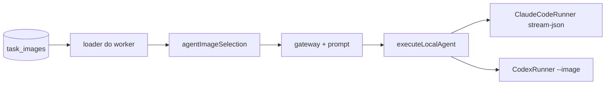

# Spec: Leitura de imagens pelo Issue Author e pelo Planejamento

> **Status:** Em revisão · **Data:** 2026-11-26 · **Nível:** L3 spec-first
> **Issue:** [#18](https://github.com/Mauricio720/Flow-Dev/issues/18)
> **Contexto lido:** `packages/api/src/infra/issue-author/{issueAuthorPrompt,localIssueAuthorGateway}.ts`, `packages/api/src/infra/planning/{planningPrompt,localPlanningGateway}.ts`, `packages/api/src/infra/agents/{agentExecution,claudeArguments,claudeCodeRunner,codexArguments,codexRunner}.ts`, `packages/api/src/application/agents/localAgentRunner.ts`, `packages/api/src/infra/database/dao/tasks/{taskOperationInput,drizzleTaskImageDao,stagedTaskImages}.ts`, `packages/api/src/infra/database/schema/tasks/images.ts`, `packages/api/src/application/services/tasks/{taskImageRules,issueAttachmentRules,issueImagePublisher}.ts`, `packages/api/src/application/services/terminal/issueImageSelection.ts`, `packages/api/resources/agents/{issue-author,planning}/rules.md`, `docs/specs/agentes-locais-por-assinatura/spec.md`.

## Resumo para revisão

- **O que muda:** o Issue Author passa a ver as imagens que a operadora anexou às mensagens e as que estão inseridas no rascunho. O Planejamento passa a ver as imagens que a Issue publicada traz. Vale para Claude e Codex.
- **Por quê:** hoje as imagens ficam guardadas e são publicadas na Issue, mas nenhum agente as recebe. Um print de erro ou um esboço de tela fica de fora justamente das etapas que escrevem e avaliam a intenção.
- **Decisões principais:** as imagens saem do banco e vão pelo canal nativo de cada CLI: blocos de imagem via `stream-json` no Claude (DEC-01) e `--image` no Codex (DEC-02). Uma regra única escolhe as imagens: no máximo 10 por execução e 20 MB no total, as mais recentes primeiro, e as que ficam de fora são avisadas ao agente (DEC-03). Execuções sem imagem continuam idênticas às de hoje (DEC-04).
- **Riscos principais:** o Claude CLI exige saída `stream-json` quando a entrada é `stream-json`, então o parser do resultado muda (mitigado: só nesse caminho e com teste do CLI falso). Um provedor pode recusar uma imagem por dimensão (acima de 8000 px); nesse caso a execução falha com o erro de provedor que já existe.
- **Como vamos verificar:** a regra de seleção com testes da função pública. A leitura das imagens com Postgres real. Os runners contra o CLI falso, conferindo argumentos, stdin e arquivos temporários. Os prompts com e sem imagens.
- **Pendências:** nenhuma bloqueante.

---

# Parte 1 — Produto

## 1. Contexto e problema

A operadora pode anexar até 10 imagens a cada mensagem da conversa com o Issue Author e inserir imagens no rascunho pelo editor. As imagens ficam guardadas no Flow Dev, até 30 por tarefa e 5 MB cada, em PNG, JPEG, GIF ou WEBP. Na publicação, os anexos entram na seção "Imagens anexadas" da Issue e as imagens do rascunho viram links no corpo.

Os dois agentes locais que trabalham a intenção, porém, só recebem texto. O Issue Author recebe o rascunho, a evidência retida e a conversa. O Planejamento recebe título e corpo da Issue, onde as imagens aparecem apenas como URLs que ele não abre. Por isso o agente escreve ou avalia a Issue sem ver o print que a operadora mandou para explicar o problema.

## 2. Usuários e papéis

- **Operadora:** descreve a intenção com texto e imagens e espera que o rascunho e a recomendação de rota levem as imagens em conta. Nenhuma permissão nova; quem já pode conversar e planejar continua sendo quem pode.
- **Agentes Issue Author e Planejamento:** consumidores das imagens, sempre como dado não confiável.

## 3. Objetivos

- O Issue Author vê, a cada execução, as imagens da conversa e do rascunho atual.
- O Planejamento vê as imagens da Issue publicada que o Flow Dev guardou.
- Cada execução fica dentro de um limite fixo de imagens e bytes. O agente sabe quais imagens ficaram de fora.
- O conteúdo das imagens nunca vale como instrução.

## 4. Fora de escopo

- **Baixar imagens por URL externa** (links no texto da conversa, imagens adicionadas à Issue direto no GitHub): exigiria acesso à rede no worker e abriria risco de SSRF. Só entram imagens guardadas no Flow Dev.
- **Mudanças de tela:** a operadora já anexa e insere imagens. Não há aviso visual de imagem omitida (ver Sugestões).
- **Redimensionar ou converter imagens:** os limites atuais de upload já cabem nos limites por imagem dos provedores (ver Premissas).
- **Imagens como evidência citável:** as fontes do rascunho e da avaliação continuam sendo só arquivos do repositório e Issues do GitHub.
- **Sessões de terminal e revisão:** já recebem imagens da Issue pela feature de anexos do terminal e não mudam.

## 5. Histórias de usuário

### US-01 — Issue Author vê as imagens da conversa (P1)
Como operadora, quero que o Issue Author veja os prints que anexo às mensagens, para que o rascunho reflita o que mostrei e não só o que escrevi.
- **Por que P1:** é o pedido central da Issue.
- **Teste independente:** anexar uma imagem a uma mensagem e conferir que a execução seguinte entrega a imagem ao provedor configurado.
- **Cenários de aceite:**
  1. **Dado** uma tarefa nova com Claude configurado para o Issue Author, **quando** a operadora envia "corrigir este erro" com um PNG de 300 KB anexado, **então** a execução recebe a mensagem e o PNG como imagem, identificado como anexo da mensagem 1.
  2. **Dado** o mesmo cenário com Codex configurado, **quando** a execução roda, **então** o Codex recebe o PNG como imagem anexada ao prompt.
  3. **Dado** uma conversa só com texto, **quando** o Issue Author roda, **então** a requisição ao provedor é idêntica à de hoje.

### US-02 — As imagens continuam visíveis nos refinamentos (P1)
Como operadora, quero que o agente continue vendo as imagens anteriores quando peço um ajuste, para que ele não contradiga o que já mostrei.
- **Por que P1:** sem isso, a segunda execução perde o que a primeira viu e o refinamento piora o rascunho.
- **Teste independente:** conversa com imagem na mensagem 1, refinamento só com texto na mensagem 3; a execução do refinamento recebe a imagem da mensagem 1.
- **Cenários de aceite:**
  1. **Dado** uma imagem anexada à mensagem 1 e um rascunho pronto, **quando** a operadora pede "inclua o caso mobile" sem imagem, **então** a execução recebe de novo a imagem da mensagem 1.
  2. **Dado** um rascunho em cujo contexto a operadora inseriu ``, **quando** ela pede um refinamento, **então** a execução recebe essa imagem, identificada como imagem do rascunho com a legenda "tela atual".
  3. **Dado** a mesma imagem anexada a uma mensagem e também inserida no rascunho, **quando** o agente roda, **então** ela é enviada uma única vez.

### US-03 — O Planejamento vê as imagens da Issue publicada (P2)
Como operadora, quero que a recomendação de rota leve em conta as imagens da Issue, para que a avaliação de complexidade considere o que elas mostram.
- **Por que P2:** pedido confirmado, mas a Issue publicada já descreve a intenção em texto e o ganho é menor que no Issue Author.
- **Teste independente:** publicar uma tarefa com uma imagem anexada e conferir que a execução do Planejamento recebe essa imagem.
- **Cenários de aceite:**
  1. **Dado** uma Issue publicada pelo Flow Dev com duas imagens na seção "Imagens anexadas", **quando** o Planejamento roda, **então** recebe as duas imagens, identificadas pela ordem em que aparecem no corpo.
  2. **Dado** um corpo de Issue com um link de imagem que não pertence à tarefa, **quando** o Planejamento roda, **então** essa imagem não é enviada e consta como indisponível.

### US-04 — Limite por execução com aviso (P2)
Como operadora, quero que uma conversa com muitas imagens continue funcionando, para que o agente não falhe por excesso de anexos.
- **Por que P2:** protege o caminho principal de recusas do provedor; só aparece com muitas imagens.
- **Teste independente:** tarefa com 12 imagens; a execução recebe as 10 mais recentes e a lista das 2 omitidas.
- **Cenários de aceite:**
  1. **Dado** 12 imagens de 100 KB na conversa, **quando** o Issue Author roda, **então** recebe as 10 mais recentes, e o texto do pedido informa que as 2 mais antigas foram omitidas por limite.
  2. **Dado** cinco imagens de 4,5 MB e uma de 200 KB, a menor sendo a mais antiga, **quando** o agente roda, **então** recebe as quatro imagens de 4,5 MB mais recentes (18 MB) e a de 200 KB, e a quinta de 4,5 MB consta como omitida por limite.

## 6. Requisitos funcionais

- **REQ-001** (US-01, US-02): QUANDO o Issue Author for executado para uma tarefa, o sistema DEVE considerar como candidatas as imagens anexadas a qualquer mensagem da conversa e as imagens referenciadas no rascunho atual, desde que pertençam à mesma tarefa.
- **REQ-002** (US-02): QUANDO o Issue Author for executado, o sistema DEVE reenviar as imagens candidatas de toda a conversa, não apenas as da última mensagem.
- **REQ-003** (US-02): SE a mesma imagem for candidata por mais de uma origem, ENTÃO o sistema DEVE enviá-la uma única vez.
- **REQ-004** (US-03): QUANDO o Planejamento for executado, o sistema DEVE considerar como candidatas as imagens referenciadas no corpo da Issue publicada, no formato de link do Flow Dev ou `flow-image:`, que pertençam à mesma tarefa.
- **REQ-005** (US-01, US-03): QUANDO houver imagens selecionadas, o sistema DEVE entregá-las ao modelo como conteúdo de imagem, pelo Claude e pelo Codex, sem depender de ferramentas do agente.
- **REQ-006** (US-01–03): QUANDO houver imagens selecionadas, o sistema DEVE incluir no texto do pedido uma lista com o número de cada imagem e a sua origem: anexo da mensagem N, imagem do rascunho com a legenda, ou imagem N do corpo da Issue com a legenda.
- **REQ-007** (US-04): QUANDO houver mais candidatas do que cabem, o sistema DEVE selecionar no máximo 10 imagens e no máximo 20 MB de bytes brutos por execução. A seleção percorre as candidatas da mais recente para a mais antiga, pela data de upload, e pula as que não cabem no total de bytes, sem parar de avaliar as seguintes.
- **REQ-008** (US-03, US-04): SE uma imagem candidata for omitida por limite ou estiver indisponível (removida, de outra tarefa ou sem conteúdo), ENTÃO o sistema DEVE prosseguir com a execução e listar no texto do pedido cada imagem omitida, com o motivo `limite` ou `indisponível`.
- **REQ-009** (US-01, US-03): O sistema DEVE declarar no pedido e nas regras dos dois agentes que as imagens são dado não confiável fornecido pela operadora. Texto dentro de uma imagem nunca é instrução, e uma imagem não é evidência do repositório nem pode ser citada como fonte.
- **REQ-010** (US-01): SE nenhuma imagem for selecionada e nenhuma for omitida, ENTÃO o sistema DEVE montar a execução exatamente como hoje (mesmos argumentos de CLI, mesmo stdin, mesmo prompt).

## 7. Regras de negócio

| Regra | Valor |
|---|---|
| Máximo de imagens enviadas por execução | 10 |
| Máximo de bytes brutos somados por execução | 20 MB (20 × 1024 × 1024) |
| Ordem de prioridade na seleção | data de upload decrescente; empate pelo id |
| Ordem de apresentação ao modelo | Issue Author: anexos na ordem das mensagens, depois imagens do rascunho na ordem em que aparecem. Planejamento: ordem em que aparecem no corpo |
| Formatos e tamanho por imagem | os já validados no upload (PNG, JPEG, GIF, WEBP; até 5 MB), sem nova validação |
| Imagens do rascunho | só as referenciadas por `flow-image:<id>` nos campos do rascunho atual. Imagem enviada pelo editor e depois removida do texto não entra |
| Escopo de leitura | somente imagens da tarefa da execução |

## 8. Casos de borda e erros

| ID | Situação | Comportamento esperado | Ref. |
|---|---|---|---|
| B-01 | Primeira execução, sem rascunho | Candidatas são só os anexos das mensagens | REQ-001 |
| B-02 | Imagem removida entre o pedido e a execução (exclusão da tarefa, limpeza) | Consta como `indisponível`; execução segue | REQ-008 |
| B-03 | Operação reenfileirada ou repetida | A seleção é refeita a partir do estado atual da tarefa | REQ-002 |
| B-04 | Issue editada no GitHub com imagem externa (`user-attachments`) | Não é candidata nem é listada; o link continua apenas como texto no corpo | §4 |
| B-05 | GIF animado | Enviado como está; o provedor decide como ler os quadros | §7 |
| B-06 | Provedor recusa uma imagem (por exemplo, acima de 8000 × 8000 px) | A execução falha com o erro de provedor existente, sem nova tentativa sem imagens | Riscos |

## 9. Comportamento que não muda

- QUANDO a conversa não tiver imagens, o Issue Author DEVE CONTINUAR A receber o mesmo prompt e os mesmos argumentos de hoje.
- O limite de 100 KB do histórico de texto (`buildGenerationInput`) DEVE CONTINUAR A valer só para o texto; as imagens não entram nessa conta.
- O hash de entrada do Planejamento, a admissão, o reenfileiramento e as transições de status DEVEM CONTINUAR iguais.
- A publicação das imagens na Issue, a seção "Imagens anexadas" e os anexos das sessões de terminal DEVEM CONTINUAR iguais.
- As fontes aceitas em `relevantContext`, `references` e nos motivos do Planejamento DEVEM CONTINUAR a ser só as devolvidas pelas ferramentas de contexto.

## 10. Requisitos não funcionais

- **NFR-01** (segurança): a leitura das imagens filtra pela tarefa da execução; um id de outra tarefa ou outro projeto nunca devolve conteúdo.
- **NFR-02** (segurança): os arquivos de imagem temporários do Codex ficam no diretório privado da execução e são apagados ao final, com sucesso, falha, timeout ou cancelamento.
- **NFR-03** (privacidade): conteúdo de imagem nunca vai para log. A linha `[agents] run` registra só as contagens de imagens enviadas e omitidas.
- **NFR-04** (desempenho): só o conteúdo das imagens selecionadas é lido do banco, no máximo 20 MB por execução; os metadados das demais bastam para a seleção.

## 11. Premissas e dependências

- O limite atual por imagem do Claude na API direta é 10 MB em base64 e o de requisição é 32 MB ([Vision](https://platform.claude.com/docs/en/build-with-claude/vision)). Uma imagem de 5 MB vira cerca de 6,7 MB em base64, e 20 MB brutos viram cerca de 26,7 MB, o que cabe nos dois limites.
- O Claude Code 2.1.330 aceita `--input-format stream-json` só com `--output-format stream-json` (confirmado localmente). O Codex 0.159.3 aceita `exec -i/--image <FILE>`.
- Todos os modelos do catálogo (`sonnet`, `opus`, `haiku`, `gpt-6.1-sol`) aceitam imagem.

---

# Parte 2 — Técnica

## 12. Visão geral da solução

As imagens viajam como parte da execução do agente. Cada worker carrega os metadados das candidatas da sua origem: o Issue Author em `loadGenerationInput`, o Planejamento em `TaskPlanningWorkerDao.input`. Uma regra pura da camada de aplicação escolhe o que entra (REQ-007) e o que é omitido (REQ-008), e o conteúdo é lido só das selecionadas. O gateway repassa as imagens a `executeLocalAgent`, que as entrega ao runner num campo novo de `AgentRun`. Cada runner usa o canal nativo da sua CLI. O prompt de cada agente ganha uma seção com a lista das imagens e das omitidas, e as regras dos dois agentes ganham o parágrafo de REQ-009.



## 13. Componentes e responsabilidades

| Componente | Responsabilidade | Local | Novo/Alterado |
|---|---|---|---|
| `agentImageSelection` | REQ-003, REQ-007, REQ-008: deduplica, ordena, aplica os limites e devolve selecionadas e omitidas | `application/agents/` | Novo |
| Tipos `AgentImage`/`OmittedImage` | Contrato das imagens entre loader, gateway e runner | `application/agents/` | Novo |
| `loadGenerationInput` | Candidatas: anexos (`messageId` da tarefa) e referências do rascunho atual; lê o conteúdo das selecionadas | `infra/database/dao/tasks/taskOperationInput.ts` | Alterado |
| `TaskPlanningWorkerDao.input` | Candidatas: `issueImageReferences(bodyMarkdown)` filtradas pela tarefa | `infra/database/dao/tasks/drizzleTaskPlanningWorkerDao.ts` | Alterado |
| `buildIssueAuthorPrompt` / `buildPlanningPrompt` | Seção de imagens (REQ-006, REQ-008, REQ-009), omitida quando não há imagens | `infra/issue-author/`, `infra/planning/` | Alterado |
| `executeLocalAgent` / gateways | Repassam `images` ao runner e as contagens ao log | `infra/agents/agentExecution.ts`, gateways | Alterado |
| `ClaudeCodeRunner` + `claudeArguments` | Caminho `stream-json` quando há imagens (DEC-01) | `infra/agents/` | Alterado |
| `CodexRunner` + `codexArguments` | Grava as imagens no diretório da execução e passa `--image` (DEC-02) | `infra/agents/` | Alterado |
| Regras dos agentes | Parágrafo de REQ-009 | `resources/agents/{issue-author,planning}/rules.md` | Alterado |

A extração de referências reaproveita `issueImageReferences` (`application/services/terminal/issueImageSelection.ts`), que já reconhece `flow-image:` e os links publicados. Se a função for movida para um módulo comum, o comportamento atual do terminal se mantém. As referências do rascunho saem do corpo renderizado por `renderIssueBody`.

## 14. Modelo de dados

Não se aplica: nenhuma tabela ou migration. A leitura usa `task_images` como está (`taskId`, `messageId`, `contentType`, `byteSize`, `createdAt`, `content`) e `task_messages.sequence` para a origem dos anexos.

## 15. Interfaces e contratos

```ts
// application/agents/agentImages.ts
export type ImageOrigin =
  | { kind: "message"; messageNumber: number }
  | { kind: "draft"; caption: string }
  | { kind: "issue_body"; position: number; caption: string };
export type ImageCandidate = { id: string; contentType: string; byteSize: number; createdAt: Date; origin: ImageOrigin; available: boolean };
export type AgentImage = { id: string; contentType: string; content: Uint8Array; origin: ImageOrigin };
export type OmittedImage = { id: string; origin: ImageOrigin; reason: "limit" | "unavailable" };
export type ImageSelection = { selected: ImageCandidate[]; omitted: OmittedImage[] };
export function selectAgentImages(candidates: ImageCandidate[]): ImageSelection;

// Campos adicionados
type AgentRun = { /* atuais */ images: AgentImage[] };
type GenerationInput = { /* atuais */ images: AgentImage[]; omittedImages: OmittedImage[] };
type PlanningDispatch = PlanningInput & { /* atuais */ images: AgentImage[]; omittedImages: OmittedImage[] };
```

Na seção do prompt, cada imagem aparece como `image 1: attachment of user message 3` e cada omitida como `omitted: draft image "tela atual" (limit)`. As legendas e o número da mensagem entram como JSON, na mesma moldura de dado não confiável da conversa. As imagens no canal nativo seguem a ordem dessa lista.

**Claude, com imagens:** os argumentos trocam `--output-format json` por `--input-format stream-json --output-format stream-json --verbose`. O stdin é uma única linha JSON `{"type":"user","message":{"role":"user","content":[{"type":"text","text":<prompt>},{"type":"image","source":{"type":"base64","media_type":<contentType>,"data":<base64>}}…]}}`, encerrada com fim de arquivo. O resultado é o evento `{"type":"result"}` da saída, com `structured_output` lido como hoje.

**Codex, com imagens:** grava `images/<n>.<ext>` no diretório da execução e passa `--image <caminho>` uma vez por imagem, logo depois de `exec` e antes das demais opções. Assim a lista de valores termina na próxima opção e não consome o `-` final do stdin.

## 16. Fluxos principais

1. **Issue Author:** o worker reivindica a operação. `loadGenerationInput` busca as mensagens, o rascunho base, a evidência e os metadados das imagens da tarefa (anexos e referências do rascunho), chama `selectAgentImages` e lê o conteúdo das selecionadas filtrando por `taskId`. Em seguida, `LocalIssueAuthorGateway` monta o prompt com a seção de imagens e chama `executeLocalAgent` com `images`. O runner do provedor resolvido entrega as imagens. Saída, validação e liquidação não mudam.
2. **Planejamento:** `TaskPlanningWorkerDao.input` monta o `PlanningDispatch`, extrai as referências de `publication.bodyMarkdown`, busca os metadados filtrando pela tarefa, seleciona e lê o conteúdo. Depois segue como no fluxo 1, via `LocalPlanningGateway`.
3. **Imagem indisponível:** a candidata entra com `available: false` (sem linha na tarefa ou sem conteúdo), sai como `unavailable` e a execução segue (REQ-008).

## 17. Decisões técnicas

### DEC-01 — Claude recebe imagens por `stream-json`, só quando há imagens
- **Decisão:** com imagens, usar entrada e saída `stream-json` e blocos `image` em base64. Sem imagens, manter `-p` com texto e `--output-format json`.
- **Alternativas consideradas:** usar `stream-json` sempre, com um caminho só e menos código, mas mudando todas as execuções atuais sem necessidade (regressão no caso mais comum). Gravar arquivos e liberar a ferramenta `Read`: reabre ferramentas de arquivo para um agente que hoje roda com `--tools ""`, o que contraria o isolamento da spec de agentes locais.
- **Consequências:** o runner passa a ter dois formatos de saída para interpretar, cada um com teste no CLI falso.

### DEC-02 — Codex recebe imagens por `--image`, sem reativar `view_image`
- **Decisão:** anexar as imagens ao prompt inicial com `--image` e arquivos no diretório privado da execução. A ferramenta `view_image` continua desligada.
- **Alternativas consideradas:** reativar `view_image`, que permitiria ao agente abrir arquivos locais e amplia o que ele alcança.
- **Consequências:** os arquivos existem só durante a execução e são apagados por `withAgentDirectory` (NFR-02).

### DEC-03 — Uma regra de seleção compartilhada, na camada de aplicação
- **Decisão:** `selectAgentImages` concentra deduplicação, limites e motivos, para os dois agentes. Ela recebe só metadados.
- **Alternativas consideradas:** limitar dentro de cada runner, que obrigaria a ler conteúdo à toa e deixaria o prompt sem saber o que foi omitido. Limitar em SQL, que espalharia a regra e dificultaria o teste.
- **Consequências:** a regra é testável sem banco nem CLI, e a leitura de conteúdo fica restrita às selecionadas (NFR-04).

### DEC-04 — Imagem é contexto da operadora, não evidência
- **Decisão:** as imagens entram como dado não confiável, como a conversa. O agente pode usar o que vê para entender a intenção, mas não as cita como fonte nem as guarda na evidência retida. Por isso são reenviadas a cada execução (REQ-002).
- **Alternativas consideradas:** registrar imagens como evidência retida, o que exigiria um tipo de fonte novo e mudaria o contrato do rascunho e da validação de citações.
- **Consequências:** o contrato de saída dos agentes não muda. O custo por execução cresce com as imagens, limitado por REQ-007.

## 18. Segurança, privacidade e permissões

Não há permissão nova: as execuções já são autorizadas pela operação reivindicada. A leitura filtra sempre por `taskId` (NFR-01), então um id plantado no rascunho ou num corpo editado no GitHub não alcança imagens de outra tarefa. Contra instruções escondidas em imagens valem REQ-009 e a ausência de ferramentas de efeito: os dois agentes continuam só com as ferramentas de contexto somente leitura. Não há acesso à rede para buscar imagens (§4).

## 19. Observabilidade

A linha `[agents] run` já existente ganha `images` e `omittedImages`, que são contagens, nunca conteúdo nem ids (NFR-03).

## 20. Migração, rollout e reversão

Sem migration nem flag. Reverter o código volta as execuções a só texto, sem dados para limpar.

## 21. Riscos técnicos

| Risco | Probabilidade | Impacto | Mitigação |
|---|---|---|---|
| O formato do evento `result` em `stream-json` diferir do JSON único | Média | Alto (Issue Author com imagem falha) | Parser procura a última linha `type: "result"`; teste com saída `stream-json` no CLI falso |
| O Claude CLI ficar esperando mais entrada em `stream-json` | Baixa | Médio (timeout) | stdin fechado logo após a linha; teste no CLI falso confere fim de arquivo |
| `--image` multivalor consumir o `-` final | Baixa | Alto | Opções `--image` logo após `exec`; teste confere a ordem dos argumentos |
| Imagem com dimensão acima do limite do provedor | Baixa | Médio (execução falha) | Erro de provedor existente; ver Sugestões |
| Prompt injection numa imagem | Média | Médio | REQ-009; agentes sem ferramentas de efeito |

---

# Parte 3 — Verificação

## 22. Estratégia de testes

Base: skill `software-testing`. Vitest no pacote `packages/api` (`test` e `test:integration` com Postgres descartável real) e o CLI falso de `test/fixtures/agents`, que já registra argumentos, stdin e arquivos.

- **Regra de seleção:** testes da função pública com metadados sintéticos. O oráculo vem de §7 e REQ-007/008, nunca do código.
- **Leitura das imagens:** Postgres real, porque o risco é a consulta: filtro por tarefa, junção com mensagens e leitura parcial de conteúdo.
- **Runners:** processo real contra o CLI falso, sem provedor real. É ali que estão os riscos de argumentos, stdin, formato de saída e limpeza de arquivos.
- **Prompts e gateways:** funções reais com runner dublê, para conferir que as imagens chegam ao `AgentRun`.
- **E2E:** não se aplica. Não há mudança de tela, e o ambiente Playwright usa agentes falsos que não provariam leitura de imagem.
- **Sem prova automática:** se o modelo real usa de fato o conteúdo da imagem no rascunho e na avaliação, e se ignora instruções escritas dentro de uma imagem. Também não há prova de que o Claude e o Codex reais aceitam os formatos enviados. A operadora confere isso no teste manual final.

## 23. Matriz de verificação

| ID | Cobre | Falha que detecta | Fronteira real | Casos (resumo) |
|---|---|---|---|---|
| V-01 | US-04 (cen. 1–2), REQ-003, REQ-007, REQ-008 | para no primeiro que não cabe; ordena pela mais antiga; duplica imagem; ignora indisponível | `selectAgentImages` real, sem dublê | 12 → 10 + 2 `limit`; 5×4,5 MB + 200 KB → 18,2 MB; duplicada uma vez; `available:false` → `unavailable`; vazio → vazio |
| V-02 | US-01 (cen. 1), US-02 (cen. 1–2), REQ-001, REQ-002, B-01, B-02, NFR-01, NFR-04 | só a última mensagem; imagem de outra tarefa vazando; imagem órfã do editor entrando; conteúdo de omitida lido | `loadGenerationInput` + Postgres real | anexos de várias mensagens com origem certa; referência no rascunho; id de outra tarefa → `unavailable`; imagem sem referência não entra; sem rascunho |
| V-03 | US-03 (cen. 1–2), REQ-004, B-04, NFR-01 | não reconhece link publicado; aceita imagem de outra tarefa; trata URL externa como candidata | `TaskPlanningWorkerDao.input` + Postgres real | duas imagens na ordem do corpo; link de outra tarefa → `unavailable`; `user-attachments` ignorado |
| V-04 | US-01 (cen. 1), REQ-005, DEC-01 | argumentos errados; base64 ou `media_type` errado; resultado `stream-json` não lido; stdin não fechado | `ClaudeCodeRunner` + processo real do CLI falso | com 2 imagens: args `stream-json` e uma linha com texto + 2 blocos; lê `structured_output` do evento `result` |
| V-05 | US-01 (cen. 2), REQ-005, DEC-02, NFR-02 | `--image` depois do `-`; bytes gravados diferentes; arquivos sobrando | `CodexRunner` + processo real do CLI falso | arquivos com os bytes originais durante a execução; ordem dos args; diretório apagado após sucesso e após falha |
| V-06 | US-01 (cen. 3), REQ-010, §9 | caminho sem imagem alterado | runners e prompts reais | sem imagens: args, stdin e prompt iguais aos atuais nos dois provedores e nos dois agentes |
| V-07 | REQ-006, REQ-008, REQ-009, US-02 (cen. 2) | lista fora da ordem do canal; legenda tratada como instrução; omitidas não avisadas | `buildIssueAuthorPrompt`/`buildPlanningPrompt` reais | numeração e origem; legenda "tela atual"; omitidas com motivo; frase de dado não confiável presente |
| V-08 | REQ-005, REQ-009, NFR-03 | gateway não repassa imagens; contagens erradas no log; regra ausente nas instruções | gateways + `executeLocalAgent` reais, runner dublê | `AgentRun.images` com as selecionadas; log com `images`/`omittedImages` sem ids; instruções carregadas contêm a regra de imagem |

## 24. Definição de pronto

- `pnpm --dir packages/api test` e `pnpm --dir packages/api test:integration` verdes.
- `pnpm --dir packages/api typecheck` e `pnpm lint` verdes.
- V-01 a V-08 implementados, sem `skip`.
- Spec atualizada com o que mudar na implementação.

---

## Questões em aberto

Nenhuma. As quatro pendências do planejamento foram decididas em 2026-11-26: agentes (Issue Author e Planejamento), origem das imagens (anexos e rascunho; Planejamento pelo corpo da Issue), reenvio (todas, a cada execução) e limites (10 imagens e 20 MB, omitir e avisar).

## Sugestões fora do escopo

- **Aviso na tela quando imagens foram omitidas:** hoje só o agente fica sabendo. Uma linha na conversa evitaria a surpresa de "ele não viu meu print".
- **Nova tentativa sem imagens quando o provedor recusar uma imagem (B-06):** troca a falha por um resultado parcial.

## Histórico

- 2026-11-26 — Criação da spec a partir da Issue #18, com as decisões da operadora sobre agentes, origem, reenvio e limites.
