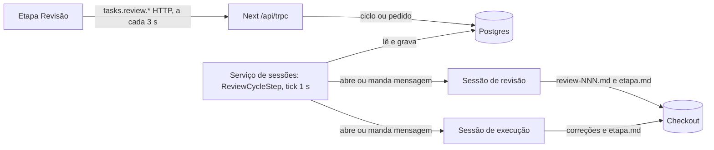

# Spec: Revisão automática da feature com revisão e execução configuráveis

> **Status:** Em revisão · **Data:** 2026-11-24 · **Nível:** L4 — spec ancorada (Issue #9)
> **Contexto lido:** Issue #9 e o pedido original em `task_messages`; `.claude/skills/spec-to-tasks/references/manifest-template.md` ("Revisão final"); `.claude/skills/spec-conformance/SKILL.md` e `references/report-template.md`; os 21 relatórios `docs/specs/*/reviews/review-*.md`; `packages/api/drizzle/0041_deterministic_review.sql`; sessões (`application/terminal/*`, `application/services/terminal/*` — em especial `messageDelivery.ts` e `sessionResume.ts` —, `infra/sessionWorkerComposition.ts`, `infra/terminal/scriptedSessionRunner.ts`, `infra/terminal/codex/codexThreadOptions.ts`); tela do trabalho (`apps/web/src/features/issues/assigned-work/`); Next 16 (`node_modules/next/dist/docs/01-app/02-guides/backend-for-frontend.md:927`); tRPC 11.19 (WebSocket, pelo Context7); cache de prompt (skill claude-api).

## Resumo para revisão

- **O que muda:** o trabalho ganha a etapa **Revisão**, depois de **Tarefas**. A pessoa operadora escolhe agente, modelo e esforço da **revisão** e da **execução** e inicia um **ciclo** com duas sessões, que continuam de rodada em rodada:
  - a sessão de revisão roda a spec-conformance, grava o relatório e escreve a próxima etapa em `reviews/etapa.md`;
  - o serviço de sessões vigia esse documento e passa a vez para a sessão de execução, que corrige e devolve com `etapa: review`.
  - O ciclo termina com Aprovada ou Aprovada com ressalvas, com uma falha ou quando a operadora para. No fim, as duas sessões são encerradas.
- **Por quê:**
  - hoje a "Revisão final" do `_tasks.md` é manual: cada rodada exige abrir sessões e colar o prompt de correção, de 2 a 8 vezes por feature;
  - a operadora quer economia: as duas sessões reaproveitam o contexto que já têm, em vez de reler tudo a cada rodada.
- **Decisões principais:**
  - o serviço de sessões conduz o ciclo (DEC-01);
  - a passagem de vez é o documento de etapa que a IA grava (DEC-02);
  - não há WebSocket: o serviço já recebe cada edição das sessões, e a tela relê o estado a cada 3 s (DEC-03);
  - são duas sessões por ciclo, continuadas de rodada em rodada (DEC-08);
  - tabelas novas, sem as legadas da migration 0041 (DEC-05).
- **Riscos principais:**
  - o ciclo, sem limite de rodadas, pode gastar a assinatura;
  - se a espera de uma sessão passar da validade do cache, o turno seguinte paga o histórico inteiro, e as conversas crescem;
  - um documento de etapa antigo pode ser lido como atual (§7.3).
- **Como vamos verificar:**
  - regras puras do documento de etapa, das transições e dos prompts;
  - o passo do ciclo com Postgres real e runtime roteirizado, provando que só duas sessões servem a todas as rodadas;
  - os componentes da etapa;
  - uma jornada e2e e um smoke opcional com o Claude real.
- **Pendências:** nenhuma.

---

# Parte 1 — Produto

## 1. Contexto e problema

Um trabalho (a feature de uma Issue) com rota PRD ou Tech Spec passa por Planejamento, Spec e Tarefas. As sessões do plano implementam as tarefas. O manifesto de tarefas termina com a "Revisão final": a skill spec-conformance revisa a feature inteira e grava um relatório numerado. O relatório traz:
- o veredito: APROVADO, APROVADO COM RESSALVAS ou REPROVADO;
- os achados por severidade;
- um "Prompt de correção".

Se o veredito for REPROVADO, vem uma rodada de correções e depois uma nova revisão. Hoje cada passo depende da operadora, e as features entregues levaram 2, 2, 3, 3, 3 e 8 revisões.

O pedido original diz: "Quero algo que consigamos definir o modelo que vai fazer a revisão, o modelo que vai consertar as issues e por meio de websocket e IA automatizar o fluxo a cada rodada que a IA define como Aprovada ou reprovada." Em 2026-11-24 a operadora detalhou o pedido para economizar: só duas sessões por ciclo, continuadas de rodada em rodada para aproveitar o contexto, com a passagem de vez feita por um documento de etapa. O "Contexto relevante" da Issue aponta uma base de revisão antiga, que já foi removida do produto (DEC-05).

## 2. Usuários e papéis

- **Pessoa operadora** (quem tem a posse do trabalho): escolhe a revisão e a execução e conduz as ações do ciclo (§7.1). Também responde perguntas e permissões das sessões do ciclo.
- **Membro com leitura do projeto:** acompanha a etapa e a conversa, sem controles.

## 3. Objetivos

- Iniciar a revisão com um clique e receber a feature revisada sem encadear sessões à mão.
- Escolher a revisão e a execução de forma independente (agente, modelo e esforço), com a escolha lembrada por trabalho.
- Usar em cada ciclo uma única sessão de revisão e uma única de execução, continuadas de rodada em rodada.
- Avançar o ciclo só pela etapa que a IA grava no documento de etapa, sem limite de rodadas, e parar quando a operadora pedir.
- Mostrar a quem está com a etapa aberta cada mudança, sem recarregar a página.

## 4. Fora de escopo

- **Trabalhos com rota Execução direta:** não há spec nem conjunto de tarefas para revisar.
- **Commit, push, PR ou escrita no GitHub depois da aprovação:** nada vai ao GitHub sem aprovação explícita.
- **Mudar a escala de vereditos ou o modelo de relatório da spec-conformance.**
- **WebSocket:** a operadora dispensou em 2026-11-24 ("se não tiver necessidade, sem problemas"). A tela relê o estado periodicamente, como as outras etapas (DEC-03).
- **Limite de rodadas:** decisão da operadora.
- **Revisão e execução padrão por projeto:** a escolha é por trabalho, por decisão da operadora.
- **Rodadas de ciclos anteriores na etapa:** os relatórios e as sessões continuam em Artefatos e Execução.
- **Ciclo conduzido por outra máquina:** o ciclo pertence ao serviço de sessões da máquina em que foi iniciado, como as sessões.

## 5. Histórias de usuário

### US-01 — Escolher revisão e execução e iniciar (P1)
Como pessoa operadora, quero escolher quem revisa e quem executa as correções e iniciar a revisão, para não encadear sessões à mão.
- **Por que P1:** é a entrada do ciclo.
- **Teste independente:** com as tarefas concluídas, iniciar abre a sessão de revisão com a escolha feita.
- **Cenários de aceite:**
  1. **Dado** 7 de 7 tarefas concluídas e nenhum ciclo, **quando** a operadora abre a etapa, **então** vê Revisão e Execução em Claude Code · Opus · Máximo e "Iniciar revisão" habilitado.
  2. **Dado** um ciclo anterior com a revisão em Claude Code · Sonnet · Alto, **quando** ela volta à etapa, **então** Revisão vem com essa escolha.
  3. **Dado** 5 de 7 tarefas concluídas, **então** "Iniciar revisão" fica desabilitado com "Faltam 2 de 7 tarefas", e "Revisar mesmo assim", confirmado, cria um ciclo parcial.
  4. **Dado** o Codex sem login, **quando** ela inicia com o Codex na execução, **então** o início é recusado com a mensagem atual de agente indisponível, sem criar ciclo.

### US-02 — Ciclo que avança sozinho com duas sessões (P1)
Como pessoa operadora, quero que a revisão e a execução passem a vez uma para a outra pelo documento de etapa, sempre nas mesmas duas sessões, para receber a feature aprovada sem intervir e sem pagar de novo pelo contexto.
- **Por que P1:** é o pedido central da Issue e da economia.
- **Teste independente:** com sessões roteirizadas (Reprovada, execução, Aprovada), o ciclo termina em Aprovada com 2 rodadas e exatamente 2 sessões abertas.
- **Cenários de aceite:**
  1. **Dado** a rodada 1, **quando** a sessão de revisão grava `review-004.md` com REPROVADO, escreve em `reviews/etapa.md` "etapa: execute" e "relatorio: docs/specs/x/reviews/review-004.md" e termina o turno, **então**:
     - a rodada 1 registra Reprovada;
     - a sessão de execução abre com o prompt de correção desse relatório;
     - a sessão de revisão fica aberta, aguardando.
  2. **Dado** a execução da rodada 1, **quando** ela grava "etapa: review" e termina o turno, **então** a mesma sessão de revisão recebe a mensagem da rodada 2, e nenhuma sessão nova é aberta.
  3. **Dado** a rodada 2, **quando** a revisão grava "etapa: aprovada", **então** o ciclo termina em Aprovada e as duas sessões são encerradas.
  4. **Dado** uma pergunta interativa da execução sem resposta há 2 horas, **então** o ciclo continua em Executando e segue quando a operadora responde.

### US-03 — Acompanhar sem recarregar (P1)
Como operadora ou membro, quero ver a rodada, a etapa, os vereditos e a conversa da sessão da vez, para saber o que acontece sem recarregar.
- **Por que P1:** avisa quando a operadora precisa agir.
- **Teste independente:** com a etapa aberta, uma mudança de etapa aparece sem recarregar.
- **Cenários de aceite:**
  1. **Dado** um membro com a etapa aberta, **quando** a revisão da rodada 2 começa, **então** ele vê "Rodada 2 · Revisando com Claude Code · Opus · Máximo" em até 5 s, e a rodada 1 com Reprovada e o link para `review-004.md`.
  2. **Dado** uma leitura do estado que falha, **então** a etapa mostra o erro de leitura padrão, e a leitura seguinte volta a mostrar o estado.
  3. **Dado** ninguém com a etapa aberta, **quando** a revisão termina, **então** o ciclo segue.

### US-04 — Parar e retomar depois de falha (P1)
Como pessoa operadora, quero parar o ciclo a qualquer momento e retomar uma etapa que falhou, para controlar o custo e as mudanças no checkout.
- **Por que P1:** sem limite de rodadas, parar é o único freio.
- **Teste independente:** "Parar revisão" encerra as duas sessões e deixa o ciclo em Parada.
- **Cenários de aceite:**
  1. **Dado** a execução da rodada 3, **quando** a operadora confirma "Parar revisão", **então** as duas sessões são encerradas, aparece "Parada por você na rodada 3" e o checkout mantém o que elas mudaram.
  2. **Dado** uma revisão que termina o turno sem atualizar `reviews/etapa.md`, **então** o ciclo vai para Parada por falha com o motivo de etapa não atualizada, mostrando "Tentar de novo" e "Encerrar revisão".
  3. **Dado** esse ciclo, **quando** ela clica "Tentar de novo", **então** a mesma sessão de revisão recebe de novo a mensagem da rodada.
  4. **Dado** esse ciclo, **quando** a operadora responde na conversa da sessão de revisão e ela grava "etapa: execute" e termina o turno, **então** o ciclo segue sozinho para a execução.

### US-05 — Decidir sobre "Aprovada com ressalvas" (P2)
Como pessoa operadora, quero aceitar as ressalvas ou pedir mais uma correção, porque ressalvas dependem da minha decisão.
- **Por que P2:** o ciclo termina sem ela; ela só fecha o caminho das ressalvas.
- **Teste independente:** uma revisão roteirizada que grava "etapa: ressalvas", seguida de aceitar, termina o ciclo.
- **Cenários de aceite:**
  1. **Dado** a rodada 2 com "etapa: ressalvas", **quando** a operadora aceita, **então** o ciclo termina em Ressalvas aceitas, com quem aceitou e quando, e as duas sessões são encerradas.
  2. **Dado** a mesma rodada, **quando** ela pede correção, **então** a mesma sessão de execução recebe a mensagem de ressalvas e, depois, a mesma sessão de revisão recebe a mensagem da rodada 3.
  3. **Dado** que outra aba já aceitou as ressalvas, **quando** ela pede correção na aba antiga, **então** recebe "A revisão mudou. Veja o estado atual." e vê Ressalvas aceitas.

## 6. Requisitos funcionais

**Etapa e início**
- **REQ-001** (US-01): ONDE o trabalho tiver um conjunto de tarefas legível, o sistema DEVE mostrar a etapa "Revisão" depois de "Tarefas", para a operadora e para os membros com leitura.
- **REQ-002** (US-01): ENQUANTO o trabalho não tiver ciclo em estado não final, o sistema DEVE mostrar à operadora os campos "Revisão" e "Execução", cada um com agente, modelo e esforço, e o botão "Iniciar revisão".
- **REQ-003** (US-01): O sistema DEVE preencher Revisão e Execução com as escolhas do último ciclo do trabalho e, sem ciclo anterior, com Claude Code · Opus · Máximo nos dois campos.
- **REQ-004** (US-01): QUANDO a operadora iniciar a revisão com todas as tarefas concluídas, o sistema DEVE criar o ciclo na rodada 1, com as duas escolhas, e abrir a sessão de revisão.
- **REQ-005** (US-01): ENQUANTO houver tarefa não concluída, o sistema DEVE desabilitar "Iniciar revisão", mostrar quantas tarefas faltam e oferecer "Revisar mesmo assim".
- **REQ-006** (US-01): QUANDO a operadora confirmar "Revisar mesmo assim", o sistema DEVE criar um ciclo parcial, em que toda mensagem de revisão pede revisão parcial à skill.
- **REQ-007** (US-01): SE uma pré-condição de abertura de sessão falhar, ENTÃO o sistema DEVE recusar o início com a mensagem atual desse motivo, sem criar ciclo. As pré-condições são: escolha indisponível ou inválida, serviço de sessões parado, checkout inválido ou skill ausente.
- **REQ-008** (US-01): SE o trabalho já tiver ciclo em estado não final, ENTÃO o sistema DEVE recusar novo início com o texto de §7.4.
- **REQ-009** (US-01): QUANDO o mesmo pedido de início se repetir, o sistema DEVE devolver o ciclo já criado.
- **REQ-010** (US-01): SE houver sessões ativas do trabalho no início, ENTÃO o sistema DEVE pedir a confirmação de §7.4 antes de criar o ciclo (Q-01).
- **REQ-011** (US-01): ENQUANTO o ciclo não estiver em estado final, o sistema DEVE manter as escolhas dele inalteradas.

**Condução**
- **REQ-012** (US-02): QUANDO a sessão de revisão terminar o turno sem pedido pendente, o sistema DEVE ler a etapa que ela gravou no documento de etapa, pelas regras de §7.3.
- **REQ-013** (US-02, US-05): QUANDO a revisão gravar uma etapa válida, o sistema DEVE seguir a transição de §7.1:
  - `execute` manda a mensagem de execução à sessão de execução, abrindo-a na primeira vez que ela for necessária;
  - `aprovada` termina o ciclo;
  - `ressalvas` espera a operadora.
- **REQ-014** (US-02): QUANDO a sessão de execução terminar o turno com "etapa: review" gravada, o sistema DEVE mandar à sessão de revisão a mensagem da rodada seguinte.
- **REQ-015** (US-02): O sistema DEVE abrir uma nova rodada a cada Reprovada, sem limite de rodadas.
- **REQ-016** (US-02): ENQUANTO a sessão da vez tiver pergunta ou permissão pendente, o sistema DEVE manter o ciclo na etapa, sem prazo.
- **REQ-017** (US-02): O sistema DEVE abrir cada sessão com o prompt inicial do papel dela e mandar as rodadas seguintes como mensagens de continuação. Os prompts e as mensagens são os de §7.5, e as sessões rodam no checkout da operadora, em nome dela e no modo de permissão padrão das sessões.
- **REQ-018** (US-02): O sistema DEVE guardar as edições de `.md` que a execução fizer na pasta do conjunto, como já faz com as sessões do plano, para a etapa Tarefas refletir o que ela atualizou.
- **REQ-019** (US-02): O sistema DEVE registrar em cada rodada:
  - o veredito;
  - o caminho e a versão guardada do relatório;
  - as sessões de revisão e de execução usadas;
  - os horários.
- **REQ-020** (US-02): O sistema DEVE manter no máximo uma sessão de revisão e uma de execução por ciclo e só abrir outra para substituir uma que não possa continuar (REQ-043), mesmo se o serviço de sessões reiniciar entre criar a sessão e registrá-la.
- **REQ-021** (US-02): QUANDO o serviço de sessões reiniciar, o sistema DEVE retomar os ciclos não finais pelo estado guardado.

**Parar, falhas e ressalvas**
- **REQ-022** (US-04): QUANDO a operadora confirmar "Parar revisão", o sistema DEVE encerrar as duas sessões e terminar o ciclo em Parada, sem desfazer mudanças no checkout.
- **REQ-023** (US-04): SE a sessão da vez não abrir, for interrompida durante a vez dela, ou já estiver encerrada quando a vez chegar, ENTÃO o sistema DEVE deixar o ciclo em Parada por falha com o motivo de §7.4.
- **REQ-024** (US-04): SE a sessão da vez terminar o turno sem gravar no documento de etapa uma etapa válida para o papel dela (§7.3), ENTÃO o sistema DEVE deixar o ciclo em Parada por falha com o motivo de §7.4.
- **REQ-025** (US-04): QUANDO a operadora pedir "Tentar de novo", o sistema DEVE mandar de novo a mensagem da etapa à mesma sessão.
- **REQ-026** (US-04): SE a pessoa que iniciou o ciclo deixar de operar o trabalho, ou o planejamento deixar de estar aprovado, ou o conjunto ficar ilegível, ENTÃO o sistema DEVE terminar o ciclo em Parada com o motivo de §7.4.
- **REQ-027** (US-04): QUANDO a Issue for excluída, o sistema DEVE terminar o ciclo e as duas sessões antes de apagar os dados.
- **REQ-028** (US-05): QUANDO a operadora aceitar as ressalvas, o sistema DEVE terminar o ciclo em Ressalvas aceitas, registrando quem aceitou e quando.
- **REQ-029** (US-05): QUANDO a operadora pedir correção das ressalvas, o sistema DEVE mandar à sessão de execução a mensagem de ressalvas de §7.5.

**Controles e acompanhamento**
- **REQ-030** (US-04, US-05): O sistema DEVE oferecer à operadora, em cada estado, exatamente as ações de §7.1.
- **REQ-031** (US-01, US-04, US-05): SE quem pedir uma ação do ciclo não for a operadora, ENTÃO o sistema DEVE recusar com o erro de operação que o trabalho já usa.
- **REQ-032** (US-04, US-05): SE uma ação chegar sobre um estado do ciclo que já mudou, ENTÃO o sistema DEVE recusá-la com o texto de §7.4 e mostrar o estado atual.
- **REQ-033** (US-03): O sistema DEVE mostrar na etapa:
  - o estado (§7.4), a rodada e a etapa atuais;
  - as duas escolhas e a marca "Parcial";
  - as rodadas, da mais recente para a mais antiga, com o veredito e o link que abre o relatório no visualizador de artefatos.
- **REQ-034** (US-03): ENQUANTO houver sessão da vez, o sistema DEVE mostrar na etapa a conversa dela, com as permissões da conversa da aba Execução.
- **REQ-035** (US-03): QUANDO o estado do ciclo ou o status da sessão da vez mudar, o sistema DEVE mostrar a mudança a quem estiver com a etapa aberta, sem recarregar a página (NFR-01).
- **REQ-036** (retirado em 2026-11-24): reconexão do WebSocket. Não há WebSocket (DEC-03).
- **REQ-037** (US-03): O sistema DEVE conduzir o ciclo com ou sem alguém com a etapa aberta.
- **REQ-038** (US-03): QUANDO alguém abrir o trabalho com um ciclo não final, o sistema DEVE abrir na etapa Revisão.
- **REQ-039** (US-03): O sistema DEVE mostrar o estado da aba conforme §7.2.

**Sessões continuadas**
- **REQ-040** (US-02, US-04, US-05): QUANDO o ciclo terminar em Aprovada, Ressalvas aceitas ou Parada, o sistema DEVE encerrar as duas sessões do ciclo.
- **REQ-041** (US-02): ENQUANTO uma sessão do ciclo trabalha, o sistema DEVE manter a outra aberta e aguardando, sem encerrá-la.
- **REQ-042** (US-02): SE a operadora conversar com a sessão que não é a da vez, ENTÃO o sistema DEVE ignorar o fim desse turno na condução do ciclo.
- **REQ-043** (US-04): SE a sessão de um papel não puder continuar (não abriu ou foi encerrada), ENTÃO, ao "Tentar de novo", o sistema DEVE abrir uma sessão nova para esse papel, com o prompt inicial dele.
- **REQ-044** (US-04): ENQUANTO o ciclo estiver em Parada por falha por etapa não atualizada, QUANDO a sessão da vez gravar uma etapa válida e terminar o turno, o sistema DEVE seguir a transição dessa etapa.

## 7. Regras de negócio

### 7.1 Estados, ações e transições

| Estado | Final? | Ações da operadora | Transições do sistema |
|---|---|---|---|
| Revisando | não | Parar revisão → Parada | `execute` → Executando · `aprovada` → Aprovada · `ressalvas` → Aprovada com ressalvas · falha → Parada por falha · REQ-026 → Parada |
| Executando | não | Parar revisão → Parada | `review` → Revisando (rodada + 1) · falha → Parada por falha · REQ-026 → Parada |
| Aprovada com ressalvas | não | Aceitar ressalvas → Ressalvas aceitas · Pedir correção → Executando, na mesma rodada | REQ-026 → Parada |
| Parada por falha | não | Tentar de novo → a mesma etapa · Encerrar revisão → Parada | etapa válida gravada pela sessão da vez (REQ-044) → a transição dela · REQ-026 → Parada |
| Aprovada · Ressalvas aceitas · Parada | sim | Iniciar revisão: ciclo novo, com sessões novas | — |

- **Invariantes:**
  - no máximo um ciclo não final por trabalho;
  - no máximo uma sessão de revisão e uma de execução ativas por ciclo;
  - cada rodada tem uma revisão e no máximo uma execução;
  - "Tentar de novo" não muda o número da rodada.
- **Sessão de execução:** só abre na primeira vez que for necessária. Um ciclo aprovado na rodada 1 não abre nenhuma.
- **Numeração dos relatórios:** segue a numeração livre da pasta, então a rodada 1 pode ser a `review-004.md`.

### 7.2 Estado da aba "Revisão"

| Situação do ciclo | Estado da aba |
|---|---|
| Sem ciclo, ou último ciclo em Parada | Pendente |
| Revisando ou Executando | Em andamento |
| Revisando ou Executando, com pergunta ou permissão pendente | Aguardando você |
| Aprovada com ressalvas | Aguardando você |
| Parada por falha | Falhou |
| Aprovada ou Ressalvas aceitas | Concluída |

Para membros, "Aguardando você" aparece como "Aguardando a pessoa operadora", como nas outras abas.

### 7.3 Documento de etapa

- **Local:** `{pasta}/reviews/etapa.md`, na pasta do conjunto de tarefas. Só as sessões do ciclo o gravam; o Flow Dev só lê.
- **Formato:** linhas `chave: valor`. O Flow Dev lê `etapa` e `relatorio` e ignora o resto. Exemplo:
  ```
  etapa: execute
  relatorio: docs/specs/x/reviews/review-005.md
  ```
- **Valores de `etapa`:**

  | Quem grava | Valor | Significado |
  |---|---|---|
  | Revisão | `execute` | Reprovada: a execução corrige o relatório indicado |
  | Revisão | `aprovada` | Aprovada |
  | Revisão | `ressalvas` | Aprovada com ressalvas |
  | Execução | `review` | Correções feitas: a revisão confere |

- **Validade:** o documento só vale se cumprir as três condições:
  - foi gravado pela sessão da vez, depois que a vez dela começou;
  - traz um valor permitido para o papel dessa sessão;
  - quando gravado pela revisão, aponta em `relatorio` um `reviews/review-NNN.md` gravado nessa mesma vez, com NNN maior que o da rodada anterior, dentro da pasta e sem "..".
- **Leitura:** quando a sessão da vez termina o turno sem pedido pendente.

### 7.4 Textos exatos

| Situação | Texto |
|---|---|
| Etapa atual | "Rodada {n} · Revisando com {escolha}" · "Rodada {n} · Executando com {escolha}" |
| Pendência na sessão | "Rodada {n} · Aguardando sua resposta na conversa" (membros: "Rodada {n} · Aguardando a pessoa operadora") |
| Estados de espera e finais | "Aprovada na rodada {n}" · "Aprovada com ressalvas na rodada {n}. Aceite as ressalvas ou peça mais uma correção." · "Ressalvas aceitas na rodada {n}" · "Parada por você na rodada {n}" · "Parada por falha na rodada {n}: {motivo}" · "Parada na rodada {n}: {motivo}" |
| Sem ciclo (membro) | "A revisão ainda não começou." |
| Tarefas faltando | "Faltam {k} de {n} tarefas" |
| Ação registrada, à espera do serviço | "Aplicando…" |
| Recusas | "Já existe uma revisão em andamento neste trabalho." · "A revisão mudou. Veja o estado atual." |
| Confirmações | Parcial: "Faltam {k} de {n} tarefas. A revisão sai marcada como parcial e vale só para o que já foi feito. Revisar mesmo assim?" · Sessões abertas: "Há {k} sessões abertas neste trabalho. A revisão pode ver mudanças que elas ainda estão fazendo. Iniciar mesmo assim?" · Parar: "As duas sessões do ciclo serão encerradas. O que elas já mudaram no checkout continua lá. Parar a revisão?" |
| Motivos de falha | "A sessão de revisão terminou sem atualizar {documento}." · "A sessão de execução terminou sem atualizar {documento}." · "O relatório indicado em {documento} não é novo." · "A sessão foi interrompida ou encerrada antes de terminar a etapa." · Se a sessão não abriu: a mensagem que ela registrou. |
| Motivos de parada | "Você não opera mais este trabalho." · "O planejamento não está mais aprovado." · "O conjunto de tarefas não está legível." |

O carregamento e o erro de leitura da etapa seguem o padrão da etapa Tarefas.

### 7.5 Prompts e mensagens exatos

`{documento}` é `{pasta}/reviews/etapa.md`. `{pasta}` e `{caminho}` são relativos à raiz do checkout e passam pela validação de caminho dos prompts do plano. Num ciclo parcial, toda mensagem de revisão termina com `Há tarefas não concluídas: faça a revisão parcial e marque o relatório como parcial.`

- **Revisão, prompt inicial:**

  ```
  /flow-dev:spec-conformance Revise a feature inteira contra a spec e as tarefas da pasta {pasta}. Salve o relatório em {pasta}/reviews/ com o próximo número livre e registre a linha na "Revisão final" do _tasks.md. Ao terminar, grave em {documento} a linha "etapa: execute" se o veredito for REPROVADO, "etapa: aprovada" se for APROVADO ou "etapa: ressalvas" se for APROVADO COM RESSALVAS, e a linha "relatorio: " com o caminho do relatório.
  ```

- **Revisão, continuação:**

  ```
  A execução terminou as correções. Revise de novo a feature com a mesma skill, conferindo as correções e tudo o que elas tocaram. Salve um relatório novo em {pasta}/reviews/ e atualize {documento} como na primeira vez.
  ```

- **Execução, prompt inicial:**

  ```
  Corrija os achados do relatório {caminho}, na ordem do "Prompt de correção" dele, e rode as verificações que ele pede antes de terminar. Não altere a spec nem os relatórios de revisão. Não faça commit, push nem PR sem eu pedir. Ao terminar, grave a linha "etapa: review" em {documento}.
  ```

- **Execução, continuação:**

  ```
  A revisão reprovou de novo em {caminho}. Corrija os achados dele como antes e, ao terminar, grave "etapa: review" em {documento}.
  ```

- **Execução de ressalvas** (vale também quando a sessão de execução ainda não existe):

  ```
  Corrija as ressalvas do relatório {caminho} que dependem de código, na ordem do "Prompt de correção" dele, e rode as verificações que ele pede antes de terminar. Não altere a spec nem os relatórios de revisão. Não faça commit, push nem PR sem eu pedir. Ao terminar, grave "etapa: review" em {documento}.
  ```

- **"Tentar de novo":** manda de novo a última mensagem da etapa à mesma sessão. Uma sessão substituta (REQ-043) recebe o prompt inicial do papel, com o relatório atual.

## 8. Casos de borda e erros

| ID | Situação | Comportamento esperado | Ref. |
|---|---|---|---|
| B-01 | A execução termina o turno com uma pergunta escrita, sem gravar a etapa | Parada por falha (etapa não atualizada). Se a operadora responder na conversa e a sessão gravar "etapa: review", o ciclo segue | REQ-024, REQ-044 |
| B-02 | A revisão grava dois relatórios na mesma vez | Vale o indicado em `relatorio` | §7.3 |
| B-03 | O documento aponta um relatório antigo | Falha: "O relatório indicado em {documento} não é novo." | REQ-024 |
| B-04 | Num ciclo não parcial, uma tarefa volta a "em andamento" e a skill para sem gravar a etapa | Parada por falha; a operadora pode encerrar e iniciar um ciclo parcial | REQ-024 |
| B-05 | Duas abas pedem ações ao mesmo tempo | A primeira vale; a segunda recebe "A revisão mudou. Veja o estado atual." | REQ-032 |
| B-06 | Um modelo sai do catálogo do Codex no meio do ciclo | A sessão que ainda vai abrir, ou que precisa ser substituída, não abre e mostra a mensagem atual de modelo indisponível. A saída é encerrar e iniciar outro ciclo | REQ-023 |
| B-07 | A operadora abre uma sessão manual durante o ciclo | Continua permitido, com o "Abrir outra?" de hoje; o ciclo ignora sessões que não são dele | §9 |
| B-08 | (retirado em 2026-11-24: canal de tempo real; não há WebSocket) | — | — |
| B-09 | O serviço de sessões reinicia no meio do ciclo | A sessão da vez fica interrompida e o ciclo vai para Parada por falha; "Tentar de novo" a retoma com o histórico. A outra sessão, que só aguardava, volta sozinha ao receber a próxima mensagem | REQ-021, REQ-023, REQ-025 |
| B-10 | A operadora interrompe ou encerra pela conversa a sessão da vez | Parada por falha. Se ela só interrompeu e depois a sessão gravar uma etapa válida, o ciclo segue | REQ-023, REQ-044 |
| B-11 | A operadora conversa com a sessão que aguarda a vez | O fim desse turno não conduz o ciclo. Se a conversa mudar arquivos, a etapa seguinte vê as mudanças | REQ-042 |
| B-12 | `reviews/etapa.md` já existe com o valor de um ciclo anterior | É ignorado até a sessão da vez gravá-lo na vez dela | §7.3 |

## 9. Comportamento que não muda

- QUANDO a operadora abrir sessões pela rota, pela geração de tarefas ou pelo plano, o sistema DEVE CONTINUAR A abri-las como hoje, com a confirmação "Abrir outra?".
- O sistema DEVE CONTINUAR A mostrar todas as sessões no histórico da aba Execução, inclusive as do ciclo, com conversa, eventos e artefatos.
- O sistema DEVE CONTINUAR A ler a conversa das sessões e o detalhe do trabalho com a frequência de hoje.
- As skills spec-conformance e spec-to-tasks e a revisão manual DEVEM CONTINUAR a funcionar fora do ciclo.
- O Flow Dev DEVE CONTINUAR sem escrever no repositório nem no GitHub por conta própria. Só as sessões escrevem no checkout, inclusive o documento de etapa.
- A exclusão da Issue DEVE CONTINUAR a apagar tudo do trabalho, agora com ciclos e rodadas.
- A base de revisão antiga, que o produto já removeu, DEVE CONTINUAR intacta (DEC-05).

## 10. Requisitos não funcionais

- **NFR-01** (acompanhamento): QUANDO o estado do ciclo ou o status da sessão da vez mudar, a etapa aberta DEVE mostrar a mudança em até 5 s, com o serviço de sessões no ar.
- **NFR-02** (condução): a etapa seguinte DEVE começar (mensagem enviada ou sessão criada) em até 3 s depois que a sessão da vez termina o turno com a etapa gravada.
- **NFR-03** (retirado em 2026-11-24): segurança do canal de tempo real. Não há WebSocket (DEC-03).
- **NFR-04** (custo): o ciclo DEVE usar no máximo uma sessão de revisão e uma de execução, além das substitutas de REQ-043, e mandar cada rodada como mensagem a elas, sem nova tentativa automática.
- **NFR-05** (acessibilidade):
  - os controles DEVEM ter rótulo e foco visível e funcionar por teclado;
  - as confirmações DEVEM seguir o padrão das que a tela já tem;
  - as mudanças de etapa e de veredito DEVEM ser anunciadas a leitores de tela sem interromper a leitura.
- **NFR-06** (operação): toda transição do ciclo e toda leitura do documento de etapa DEVE gerar uma linha de log (§19).

## 11. Premissas e dependências

- **"Modelo":** é o trio agente, modelo e esforço, como nas sessões do plano.
- **Quem decide o quê:** a IA grava a etapa e o Flow Dev segue a regra fixa de §7.1. Não há um terceiro modelo orquestrando.
- **Modo de permissão:** as sessões do ciclo usam o padrão das sessões, o mesmo da abertura manual. Nesse modo o Codex grava em qualquer lugar; nos outros, só dentro do checkout, onde está o documento de etapa.
- **Spec e relatórios intocados:** os prompts de execução proíbem mudá-los. Mudar o rumo da feature é decisão da operadora, que edita a spec.
- **Cache de contexto:**
  - o provedor guarda o início da conversa por tempo limitado. Na API da Anthropic, são 5 minutos por padrão, com opção de 1 hora, e a leitura em cache custa cerca de 10% da entrada normal;
  - o Flow Dev não controla a validade que o Claude Code e o Codex usam;
  - se a espera de uma sessão passar desse tempo, o turno seguinte reenvia o histórico sem desconto. O ganho que vale sempre é não reler spec, tarefas e código a cada rodada.
- **Conversa crescente:** sem limite de rodadas, o histórico das duas sessões cresce. O Claude Code e o Codex compactam a conversa perto do limite.
- **Codex:** termina o turno e guarda artefatos como o Claude (Spec E) e já reconhece o prefixo `/flow-dev:spec-conformance`.
- **Serviço de sessões:** sem ele no ar, o ciclo não avança.
- **Contas por trabalho (Issue #6):** quando essa spec entrar, as sessões do ciclo seguem a conta escolhida no trabalho.
- **Aba inicial (REQ-038):** escolha minha. Com um ciclo em andamento, hoje a tela abriria em Execução, porque há sessão ativa.

---

# Parte 2 — Técnica

## 12. Visão geral da solução

O ciclo é uma máquina de estados no Postgres. Quem a conduz é o `ReviewCycleStep`, um passo novo do serviço de sessões que roda no tick de 1 s (`infra/sessionWorkerComposition.ts`).

Cada ciclo tem duas sessões `flow_dev` comuns, com as finalidades `review` e `review_execute`. Cada uma abre na primeira vez que o papel dela é necessário. Nas rodadas seguintes, recebe uma mensagem nova pelo mesmo caminho das mensagens da operadora: `insertUserMessage` mais o `MessageDeliveryStep`. Uma sessão interrompida volta pelo `SessionResumeStep` quando a mensagem chega.

A passagem de vez é o documento `reviews/etapa.md`. O serviço já recebe cada edição das sessões como evento `file_edit`. Quando a sessão da vez termina o turno, ele faz quatro coisas:
1. confere se ela gravou o documento na vez dela;
2. lê a etapa;
3. registra a rodada;
4. manda a mensagem à outra sessão.

A web só cria ciclos e registra pedidos, e a tela relê o estado a cada 3 s enquanto o ciclo não termina.



## 13. Componentes e responsabilidades

| Componente | Responsabilidade | Local | Novo/Alterado |
|---|---|---|---|
| Regras do ciclo | §7.1, ações por estado | `application/services/review/reviewCycleRules.ts` | Novo |
| Leitor do documento de etapa | §7.3 | `application/services/review/reviewStageReader.ts` | Novo |
| Prompts e mensagens | §7.5, com a validação de caminho de `taskPlanPrompts.ts` | `application/services/review/reviewPrompts.ts` | Novo |
| Início e pedidos | REQ-002–011, REQ-028–032, com `WorkAuthorization` | `controllers/reviewCycleController.ts`, `application/services/review/reviewCycleService.ts` | Novo |
| Passo do ciclo | REQ-012–027, REQ-040–044 | `application/services/review/reviewCycleStep.ts` e partes | Novo |
| Abertura e mensagem sem requisição HTTP | extrair de `TerminalSessionController.start` a criação da sessão, a preparação do contexto e a gravação do prompt; mandar mensagem do sistema com `insertUserMessage` | `application/services/terminal/` | Alterado |
| Finalidades | `review` e `review_execute` em `SESSION_PURPOSES`; a execução captura a pasta do conjunto como o plano (REQ-018) | `application/terminal/sessionPurposeKind.ts`, `terminalEventIngestion.ts` | Alterado |
| DAOs | ciclos, rodadas, visão do ciclo | `application/database/dao/reviewCycleDao.ts`, `infra/database/dao/review/` | Novo |
| Procedures HTTP | `tasks.review.get`, `start`, `request` | `routers/review.ts`, `routers/tasks.ts` | Novo / Alterado |
| Composição do serviço | registrar o passo | `infra/sessionWorkerComposition.ts` | Alterado |
| Exclusão | parar o ciclo e apagar as tabelas novas | `deletionPurge.ts` e a parada coordenada | Alterado |
| Etapa Revisão | aba, formulário, estado, rodadas, conversa, confirmações; leitura a cada 3 s, no padrão de `usePlanView` | `apps/web/src/features/issues/assigned-work/`: `components/Review*.tsx`, `hooks/useReviewStage.ts`, `reviewModel.ts`, `reviewCopy.ts` | Novo |
| Abas | inserir Revisão e escolher a aba inicial (REQ-038) | `OperatorStages.tsx`, `stageTabs.ts` | Alterado |
| Runtime roteirizado | um roteiro por sessão, com várias vezes por sessão (`wait_message` entre elas) | `infra/terminal/scriptedSessionSteps.ts` | Alterado |

## 14. Modelo de dados

Migration `0053_review_cycles.sql`, com `_rollback.sql`, registrada no journal e em `FEATURE_MIGRATIONS` (`packages/api/test/databaseMigrations.ts`). A 0052 fica para a spec da Issue #6, que a reservou (decisão da operadora em 2026-11-25); se a #6 não entrar antes do merge, o buraco no journal precisa ser fechado.

- **`task_review_cycles`:**
  - `id`, `task_id` (cascade), `project_id`, `host_id`, `started_by` e `request_key uuid`, este único junto com `started_by`.
  - `reviewer_agent|model|effort` e `executor_agent|model|effort`, com os checks de `task_session_plan_items`.
  - `review_session_id` e `execute_session_id`: a sessão atual de cada papel, com set null.
  - `tasks_folder`, `partial` e `state`, com check `reviewing|executing|caveats|failed|approved|accepted|stopped`.
  - `round ≥ 1`, `attempt ≥ 1` (cresce a cada substituta) e `revision ≥ 1` (cresce a cada gravação).
  - `step_role` (`review|execute`): o papel da vez, mantido também em Parada por falha, para "Tentar de novo" e para a tela.
  - `step_started_at`: o início da vez, usado em §7.3.
  - `pending_action` (`stop|retry|accept|fix` ou nulo), `pending_by` e `pending_at`.
  - `failure`, `stop_reason` e `ended_by`; `started_at`, `updated_at` e `ended_at`.
  - Índice único parcial em `(task_id)` com `state IN ('reviewing','executing','caveats','failed')`, e índice em `(host_id, state)`.
- **`task_review_rounds`:**
  - `id`, `cycle_id` (cascade) e `number`, único junto com `cycle_id`.
  - `review_session_id` e `execute_session_id`: as sessões usadas na rodada, com set null.
  - `verdict` (`approved|caveats|rejected` ou nulo), `report_path`, `report_version_id` (referência a `task_artifact_versions`, set null), `reviewed_at` e `executed_at`.
- **`task_terminal_sessions`:**
  - o check de `purpose` ganha `review` e `review_execute`;
  - entra `review_cycle_id` (set null), preenchido ao criar as sessões do ciclo.
- **Dados existentes:** nenhuma linha muda; trabalhos antigos não têm ciclo.

## 15. Interfaces e contratos

HTTP (processo web), `tasks.review.*`, todas com `projectId` e `taskId`:

```ts
type ReviewRole = "review" | "execute";
type ReviewStep = { role: ReviewRole; sessionId: string | null; sessionStatus: TerminalSessionStatus | null };
type ReviewRoundView = { number: number; verdict: "approved" | "caveats" | "rejected" | null; reportPath: string | null; reportArtifactId: string | null; reviewSessionId: string | null; executeSessionId: string | null };
type ReviewCycleView = {
  id: string; state: "reviewing" | "executing" | "caveats" | "failed" | "approved" | "accepted" | "stopped";
  partial: boolean; round: number; revision: number; reviewer: AgentChoice; executor: AgentChoice;
  step: ReviewStep; sessions: { review: string | null; execute: string | null };
  pendingAction: "stop" | "retry" | "accept" | "fix" | null;
  failure: string | null; stopReason: string | null; rounds: ReviewRoundView[]; startedAt: string; endedAt: string | null;
};
get(): { cycle: ReviewCycleView | null; defaults: { reviewer: AgentChoice; executor: AgentChoice }; tasks: { total: number; completed: number }; activeSessions: number; agents: AgentAvailability[] }
start(input: { requestKey: string; reviewer: AgentChoice; executor: AgentChoice; partial: boolean; allowOpenSessions: boolean }): ReviewCycleView
request(input: { cycleId: string; revision: number; action: "stop" | "retry" | "accept" | "fix" }): ReviewCycleView
```

- **Erros** (`TaskError`, pelo `errorFormatter` atual):
  - `operator_required`;
  - `review_cycle_active` (CONFLICT);
  - `review_tasks_incomplete`;
  - `review_sessions_open`, com a contagem;
  - `review_cycle_changed` (CONFLICT);
  - `review_action_invalid`;
  - os motivos que a abertura de sessão já tem.
- **Autorização:** `get` exige leitura do trabalho; `start` e `request` exigem operação.

## 16. Fluxos principais

1. **Início:**
   1. `start` chama `requireOperate` e valida o conjunto, as tarefas (ou `partial`), a ausência de ciclo não final, as sessões abertas (ou `allowOpenSessions`), as escolhas, o serviço, o checkout e a skill.
   2. Grava o ciclo em `reviewing`, na rodada 1 e tentativa 1, com o `host_id` desta máquina.
   3. No tick seguinte, o passo abre a sessão de revisão e grava `step_started_at`.
2. **Tick,** para cada ciclo desta máquina que esteja em estado não final ou tenha pedido pendente:
   1. Confere a posse (claim `claimed` com operadora igual a `started_by`), o planejamento aprovado e o conjunto legível. Se algo falhar, termina em Parada (REQ-026) e pede o fim das duas sessões.
   2. Aplica o pedido pendente e o limpa na mesma transação, incrementando `revision`:
      - `stop` pede o fim das duas sessões;
      - `retry` manda de novo a mensagem da etapa ou abre a substituta (REQ-043);
      - `accept` termina o ciclo e pede o fim das duas sessões;
      - `fix` manda a mensagem de ressalvas à execução.
   3. Se o papel da vez ainda não tem sessão, abre uma com `request_key` derivado de (ciclo, papel, tentativa). A unicidade `(user_id, request_key)`, que já existe, garante REQ-020. Erro de pré-condição leva a Parada por falha.
   4. Falha da sessão da vez leva a Parada por falha. Conta como falha: `launch_failed`; `interrupted` durante a vez; `ended` sem pedido do ciclo; ou `interrupt_requested_at` depois de `step_started_at`.
   5. Se a sessão da vez terminou um turno depois de `step_started_at` e não tem pedido pendente:
      1. procura o `file_edit` de `reviews/etapa.md` feito por ela depois de `step_started_at`;
      2. lê o arquivo do checkout e valida pelas regras de §7.3. Na revisão, força antes a captura `stop`, para guardar a versão do relatório;
      3. grava a rodada;
      4. manda a mensagem à outra sessão (ou o prompt inicial, se ela ainda não existe) e atualiza `step_started_at`; ou, se a etapa encerra o ciclo, termina o ciclo e pede o fim das duas sessões.
      5. Num ciclo em Parada por falha, uma gravação válida segue o mesmo caminho (REQ-044).
3. **Tela:** `useReviewStage` relê `tasks.review.get` a cada 3 s enquanto o ciclo não está em estado final, e logo depois de cada ação.

## 17. Decisões técnicas

### DEC-01 — O serviço de sessões conduz o ciclo
- **Decisão:** máquina de estados no banco, conduzida pelo `ReviewCycleStep`; a web só grava ciclos e pedidos.
- **Alternativas consideradas:**
  - o navegador encadear as rodadas: o ciclo morre com a aba (REQ-037);
  - um agente orquestrador: custa mais e decide transições de forma não determinística;
  - um job no Next: as rotas podem ser encerradas, e lá não há laço.
- **Consequências:** até 1 s de atraso por etapa; retomada natural depois de reinício (REQ-021).

### DEC-02 — Passagem de vez pelo documento de etapa
- **Decisão:** a etapa, e com ela o veredito, vem de `reviews/etapa.md`, gravado pela IA em formato fixo (§7.3) e lido pelo serviço quando a sessão da vez termina o turno. A versão do relatório indicado fica guardada na rodada. Decisão da operadora em 2026-11-24.
- **Alternativas consideradas:**
  - ler o título "Veredito" do relatório: era a decisão anterior. O formato varia ("Veredito parcial: …", "(sem bloqueantes)", e um relatório com "Veredito do delta: CORRIGIDO" em 21), e a execução não teria como devolver a vez;
  - contar só o fim do turno: não diz o veredito;
  - ferramenta MCP para registrar a etapa: as sessões não têm MCP do Flow Dev, e seriam dois runtimes para ligar.
- **Consequências:** o leitor fica pequeno e o formato é fixo. Uma gravação antiga ou de outra sessão não vale (§7.3). Uma sessão que esquece o documento para o ciclo com motivo explícito, e pode destravá-lo gravando depois (REQ-044).

### DEC-03 — Sem WebSocket: o serviço vigia, a tela relê
- **Decisão:** o serviço de sessões vigia o documento pelos eventos `file_edit` que já recebe, e a tela relê o estado a cada 3 s enquanto o ciclo não termina. A operadora dispensou o WebSocket em 2026-11-24.
- **Alternativas consideradas:**
  - WebSocket com tRPC subscriptions e ticket assinado no serviço de sessões: era a decisão anterior, com a dependência `ws`, uma porta nova e a autenticação própria;
  - WebSocket só de aviso: ainda traria dependência e porta;
  - SSE por `/api/trpc`: um canal novo sem ganho para um estado que muda poucas vezes por rodada. As rotas do Next 16 também não aceitam WebSocket (`backend-for-frontend.md:927`).
- **Consequências:** sem dependência nem porta nova. A tela mostra a mudança em até 5 s (NFR-01). A leitura passa pela checagem de leitura já em cache (`ReadAccessGate`). A restrição de WebSocket da Issue deixa de valer.

### DEC-04 — (retirada em 2026-11-24) Ticket assinado em `connectionParams`
Não há WebSocket (DEC-03).

### DEC-05 — Tabelas novas, sem as legadas da 0041
- **Decisão:** `task_review_cycles`, `task_review_rounds` e as finalidades novas de sessão.
- **Alternativas consideradas:** reaproveitar `task_execution_actions` (`review_round`, `review_fix`) e `task_execution_runs.review_result`.
  - São da execução do CompozyOS, removida em `c78d44d` e `a7f359e`, e hoje só aparecem no schema e em `deletionPurge.ts`.
  - Não se ligam às sessões atuais e são protegidas pelo V-43e da Spec D.
- **Consequências:** a exclusão apaga duas tabelas a mais; as legadas não mudam.

### DEC-06 — (retirada em 2026-11-24) Evento com a visão inteira
Não há WebSocket (DEC-03).

### DEC-07 — Escolha lembrada pelo último ciclo
- **Decisão:** os padrões de `get` vêm do ciclo mais recente do trabalho.
- **Alternativas consideradas:**
  - tabela de configuração por trabalho: mais estado, sem ganho;
  - padrão do projeto: recusado pela operadora.
- **Consequências:** a escolha só fica lembrada depois de usada num ciclo.

### DEC-08 — Duas sessões por ciclo, continuadas de rodada em rodada
- **Decisão:** uma sessão de revisão e uma de execução por ciclo. Cada rodada é uma mensagem nova nelas, pelo caminho que a operadora já usa. Decisão da operadora em 2026-11-24, por economia.
- **Alternativas consideradas:**
  - sessão nova a cada etapa: era a decisão anterior. Dá contexto limpo, mas relê spec, tarefas e código e recarrega a skill a cada rodada;
  - uma sessão só para revisar e corrigir: o revisor corrigiria os próprios achados, o que a spec-conformance aponta como viés, e não daria para usar modelos diferentes.
- **Consequências:**
  - o contexto é reaproveitado, e o cache também, quando a espera cabe na validade dele (§11);
  - as conversas crescem e podem ser compactadas pelo agente;
  - uma sessão que cai volta com o histórico pela retomada existente;
  - ficam até dois processos de agente vivos por ciclo.

## 18. Segurança, privacidade e permissões

- **Autorização:** `start` e `request` passam por `WorkAuthorization.requireOperate` no controller, e `get` por `requireRead`. O passo age em nome de `started_by` e confere a posse no banco a cada tick (REQ-026).
- **Documento de etapa:** é escrito pelas sessões no checkout. O Flow Dev só o lê e valida o caminho do relatório: dentro da pasta, sem "..", sem caminho absoluto.
- **Sessões do ciclo:** têm a mesma confiança das manuais (mesmo modo de permissão, mesmo checkout).

## 19. Observabilidade

O serviço de sessões grava linhas `[review]`: `cycle_started`, `step_opened`, `step_continued`, `stage_read` (etapa e relatório), `step_failed` e `cycle_finished`, com `cycleId`, `taskId`, `round`, `role`, `sessionId` e `durationMs`. Nenhuma linha leva conteúdo de relatório nem de prompt.

## 20. Migração, rollout e reversão

1. **Migration nova com rollback:** o rollback troca as finalidades `review` e `review_execute` por `route` e apaga a coluna nova das sessões e as tabelas novas.
2. **Sem dependência nem variável nova;** o `pnpm dev` já sobe o serviço de sessões.
3. **Reversão com ciclo em andamento:** reverter o código deixa as sessões abertas como sessões comuns. Os relatórios e o `reviews/etapa.md` continuam no repositório.

## 21. Riscos técnicos

| Risco | Prob. | Impacto | Mitigação |
|---|---|---|---|
| Ciclo sem limite que não converge (uma "spec a discutir" reprova sempre) | Média | Alto: assinatura e tempo | Parar sempre visível, rodada no título, histórico por rodada; ver sugestões |
| A espera passa da validade do cache e o histórico cresce | Alta | Médio: custo por turno e detalhes perdidos na compactação | Mensagens de continuação curtas; Parar; ver sugestões (tokens por turno) |
| Documento de etapa antigo ou gravado pela sessão errada | Média | Alto: etapa errada | Só vale a gravação da sessão da vez depois do início da vez (§7.3); o relatório precisa ser novo |
| A IA não grava o documento no formato | Média | Médio | Formato curto e instruído no prompt; falha explícita; REQ-044 destrava pela conversa |
| Execução deixa o checkout quebrado | Média | Médio | A revisão seguinte roda as verificações; a operadora pode parar |
| Disputa entre o tick e os pedidos da web | Média | Médio | A web só grava pedidos; transições numa transação, com `revision` (REQ-032) |

---

# Parte 3 — Verificação

## 22. Estratégia de testes

Base: skill `software-testing`. Vitest em `packages/api` (unitário e `test:integration` com Postgres descartável real) e em `apps/web` (Testing Library); Playwright em `apps/web/e2e`.

- **Fronteiras reais:**
  - Postgres onde constraint, transação ou consulta são o risco: unicidade do ciclo, `request_key` e exclusão;
  - a entrega de mensagens e a retomada de sessão que já existem, porque são o caminho das continuações;
  - leitura do documento de etapa no checkout de teste.
- **Dublês:**
  - runtime roteirizado no lugar de Claude e Codex, estendido para um roteiro por sessão com várias vezes (`wait_message` entre elas), usando `write_file` para o relatório e para `reviews/etapa.md`;
  - relógio controlado nos horários;
  - temporizador falso na leitura periódica da tela.
- **Prazos:** NFR-02 é provado por tick: a mensagem ou a sessão seguinte nasce na mesma execução do passo, sem esperas fixas.
- **Jornada crítica:** a operadora inicia e vê Reprovada, Executando e Aprovada sem recarregar. Os e2e da tela do trabalho estão `test.fixme` por causa da verificação do GitHub. O substituto automático é o V-05, como o `task-plan-journey.test.ts` da Spec D.
- **Sem prova automática:**
  - se a spec-conformance real grava o documento como §7.5 pede (smoke opcional V-15);
  - o acerto real de cache;
  - o Codex real.

## 23. Matriz de verificação

| ID | Cobre | Falha que detecta | Fronteira real | Casos (resumo) |
|---|---|---|---|---|
| V-01 | REQ-012, REQ-024, §7.3, B-02, B-03, B-12 | documento antigo aceito; valor de outro papel aceito; relatório velho aceito | função pura com eventos e arquivo de exemplo | quatro valores por papel; gravação antes do início da vez; gravação pela outra sessão; relatório com NNN não maior; relatório fora da pasta ou com ".."; linhas extras ignoradas |
| V-02 | §7.1, REQ-013–015, REQ-022, REQ-025, REQ-028–030, REQ-044 | transição proibida aceita; "Tentar de novo" muda a rodada; limite escondido | regras puras | estados × ações; rodada 7 vai para 8; ação inválida recusada; gravação válida tira o ciclo de Parada por falha |
| V-03 | REQ-006, REQ-017, §7.5 | continuação sem a frase parcial; caminho com ".."; mensagem de ressalvas sem as regras | regras puras | prompts iniciais, continuações, ressalvas e substituta exatos; caminho inválido recusado; prefixo reconhecido por `codexTurnInput` |
| V-04 | US-01 cen. 1–4, REQ-001–011, REQ-031 | não operadora inicia; dois ciclos ativos; padrões errados; ciclo parcial sem marca | controller, serviço e Postgres real; catálogo de agentes falso | padrão Opus · Máximo; padrões do último ciclo; "Faltam 2 de 7"; parcial; Codex indisponível; mesma chave, mesmo ciclo; `review_cycle_active`; `review_sessions_open` com contagem; FORBIDDEN |
| V-05 | US-02 cen. 1–3, US-03 cen. 3, US-05 cen. 1–2, REQ-012–014, REQ-018–021, REQ-028–029, REQ-037, REQ-040–041, NFR-02, NFR-04, NFR-06 | sessão nova a cada rodada; sessão da revisão encerrada entre rodadas; Tarefas não reflete a execução; sessões vivas depois do fim | `ReviewCycleStep`, DAOs, entrega e retomada reais, Postgres real, runtime roteirizado e captura real | Reprovada, execução, Aprovada com exatamente 2 sessões e as mensagens nas mesmas sessões; aprovado na rodada 1 sem abrir a execução; ressalvas aceitas encerra as duas; ressalvas, correção e rodada 3 nas mesmas sessões; `_tasks.md` editado pela execução vira versão nova; um tick dispara a etapa seguinte; logs por transição |
| V-06 | US-04, REQ-020–027, REQ-042–044, NFR-04, B-01, B-04, B-06, B-09–B-11 | ciclo segue depois de falha; sessão duplicada depois de queda; turno fora da vez conduz o ciclo | como V-05 | falha ao abrir; crash da sessão da vez e retomada com histórico; outra sessão interrompida volta com a mensagem; encerrada e substituída; interrompida pela pessoa; sem documento; posse perdida; planejamento refeito; queda entre criar e registrar, uma sessão só; conversa fora da vez ignorada; gravação depois da conversa destrava; exclusão; nenhuma tentativa automática |
| V-07 | US-02 cen. 4, REQ-016 | ciclo avança com pergunta pendente | como V-05, roteiro com `ask` e `permission` | ciclo continua em Executando; com a resposta, segue |
| V-08 | US-05 cen. 3, REQ-032, B-05 | ação aplicada sobre estado velho | serviço e Postgres real, duas chamadas concorrentes | a segunda recebe `review_cycle_changed` |
| V-09 | US-03 cen. 1–2, REQ-035, NFR-01 | tela parada até recarregar; leitura contínua depois do fim | hook e componentes, com temporizador falso e API falsa | relê a cada 3 s com ciclo não final; para em estado final; relê depois de ação; erro de leitura padrão e volta na leitura seguinte |
| V-10 | (retirado em 2026-11-24: ticket do WebSocket) | — | — | — |
| V-11 | US-01, US-04, US-05 (tela), REQ-002, REQ-005, REQ-030, REQ-033–034, §7.4, NFR-05 | botão errado para o estado; confirmação ausente; membro com controles; texto diferente | componentes | estados × botões; três confirmações; lista de rodadas; conversa da sessão da vez; membro sem controles; anúncio a leitores de tela |
| V-12 | REQ-038–039, §7.2 | aba no lugar errado; estado de aba errado; abre em Execução com ciclo ativo | funções puras e `OperatorStages` | ordem das abas; mapeamento de §7.2; aba inicial |
| V-13 | §9, REQ-027, DEC-05, B-07 | legadas alteradas; sessões manuais mudaram; exclusão esquece tabelas; rollback quebra | Postgres real | colunas das `task_execution_*` iguais (como V-43e); rota e plano abrem como antes; o ciclo ignora sessão manual; exclusão apaga ciclos e rodadas; migrar e reverter com sessões `review` |
| V-14 | US-01–03 ponta a ponta | partes desconectadas na tela | Playwright, app, serviço de sessões, runtime roteirizado e banco de teste | inicia e vê Reprovada, Executando e Aprovada sem recarregar (`test.fixme` enquanto valer o bloqueio do GitHub) |
| V-15 | DEC-02, DEC-08 com a skill real | a skill real não grava o documento como pedido; a continuação não gera relatório novo | Claude real numa fixture pequena, opcional (`FLOW_DEV_REAL_CLAUDE=1`) | a primeira revisão grava `reviews/etapa.md` válido; a continuação na mesma sessão grava relatório novo e atualiza o documento |

## 24. Definição de pronto

- **Comandos:** `pnpm typecheck`, `pnpm lint`, `pnpm --dir packages/api test`, `pnpm --dir packages/api test:integration` (sem `TEST_DATABASE_URL`), `pnpm --dir apps/web test` e `pnpm build` passando.
- **E2E:** `pnpm --dir apps/web test:e2e review-cycle.spec.ts` passando, ou `test.fixme` com o motivo registrado e o V-05 verde como substituto.
- **Smoke:** o V-15 foi feito pela operadora, ou está registrado como não feito.
- **Spec:** nenhum `[PRECISA ESCLARECER]`; spec e `_tasks.md` atualizados com o que mudou na implementação.

---

## Questões em aberto

- **Q-01 (respondida em 2026-11-24):** ao iniciar a revisão com outras sessões do trabalho abertas (por exemplo, uma sessão do plano parada em "aguardando"), o que fazer?
  - **Resposta da operadora:** pedir confirmação com a contagem (REQ-010), como o "Abrir outra?" de hoje. As opções de bloquear até encerrá-las e de ignorar foram recusadas.

## Sugestões fora do escopo

- **Registrar os tokens de cache por turno das sessões do ciclo** (lidos e gravados): mostra se a continuação está mesmo economizando.
- **Parar sozinho quando duas revisões seguidas trouxerem os mesmos achados:** protege o ciclo sem limite contra rodadas que não convergem.
- **Oferecer abrir o PR pela skill git-workflow depois de Aprovada,** com confirmação.
- **Mostrar na etapa o histórico de ciclos anteriores.**

## Histórico

- **2026-11-24 — Criação da spec** a partir da Issue #9, com as decisões da operadora em duas rodadas de perguntas:
  - sem limite de rodadas;
  - ciclo automático, com Parar;
  - ressalvas encerram e a operadora decide;
  - escolha por trabalho, lembrando a última;
  - início com tarefas concluídas, ou parcial com confirmação;
  - falha para e mostra o motivo;
  - relatórios no repositório;
  - WebSocket no serviço de sessões.
- **2026-11-24 — Q-01 respondida:** pedir confirmação. A operadora decidiu manter uma spec só, mesmo acima das 6.000 palavras de L4.
- **2026-11-24 — Revisão da operadora, por economia:**
  - duas sessões por ciclo, revisão e execução, continuadas de rodada em rodada, e encerradas no fim do ciclo;
  - passagem de vez pelo documento `reviews/etapa.md`, gravado pelas sessões;
  - WebSocket dispensado ("se não tiver necessidade, sem problemas"): o serviço de sessões vigia o documento, e a tela relê a cada 3 s;
  - "Corretor" virou "Execução", e o estado "Corrigindo" virou "Executando";
  - as contagens por severidade saíram da tela.
  - **Retirados:** REQ-036, NFR-03, B-08, DEC-04, DEC-06 e V-10.
  - **Alterados:** REQ-002, REQ-003, REQ-012–014, REQ-017, REQ-019, REQ-020, REQ-022–025, REQ-029, REQ-033–035; NFR-01, NFR-02, NFR-04, NFR-06; DEC-02, DEC-03; §7.1, §7.3, §7.4, §7.5; B-01, B-03, B-06, B-09, B-10; V-01–V-03, V-05, V-06, V-09, V-11, V-14, V-15.
  - **Novos:** REQ-040–044, DEC-08, B-11 e B-12.
- **2026-11-25 — Quebra em tarefas (spec-to-tasks), com duas decisões da operadora:**
  - `task_review_cycles` ganha `step_role`, o papel da vez, que a §14 não tinha;
  - a migration é a 0053, deixando a 0052 para a Issue #6.
